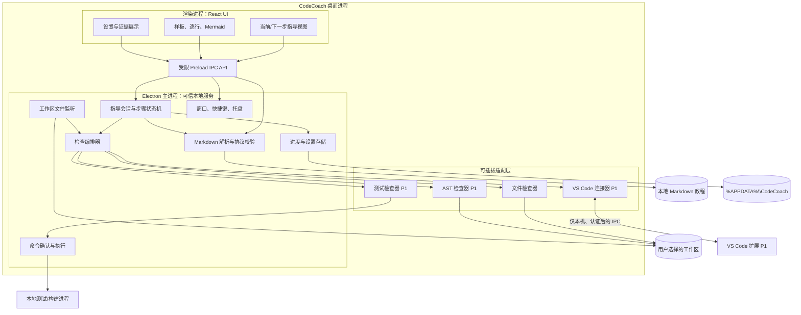
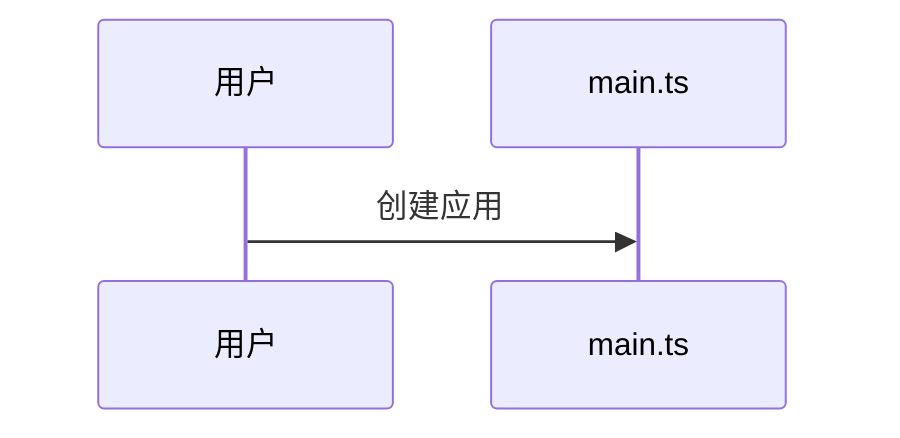
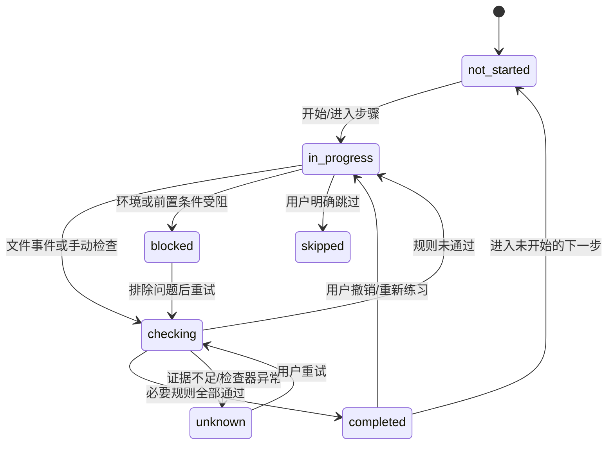
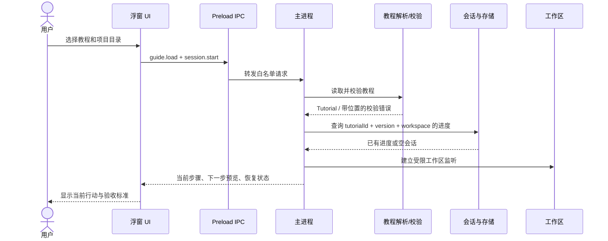
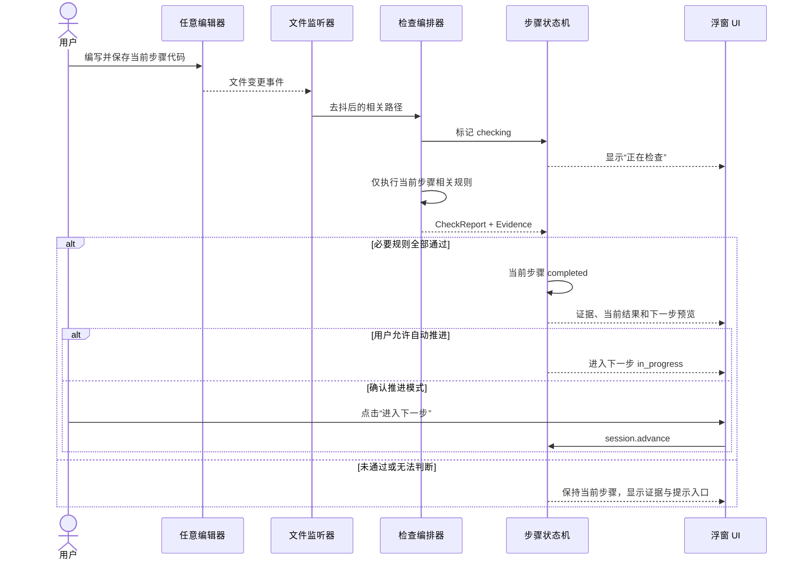
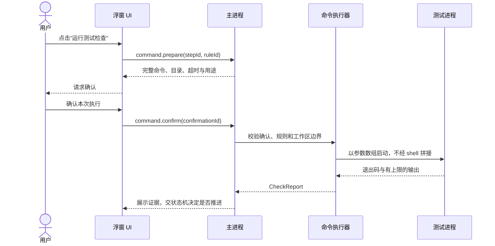

# CodeCoach 产品与技术设计

- 文档状态：草案 v0.1
- 产品代号：CodeCoach（正式名称待定）
- 目标平台：Windows 10/11 64 位
- 首选技术路线：Electron + React + TypeScript，可选 VS Code 扩展
- 核心原则：本地优先、证据驱动、用户可控、最小干扰

## 1. 背景与开源方案调研

### 1.1 调研结论

存在相近的开源项目，但截至本次调研，暂未发现一个完全覆盖“独立 Windows 置顶半透明浮窗 + 约定式 Markdown + 代码进展验证 + 逐行指导 + 时序图预览”的成熟应用。该结论仅表示本次公开资料检索未发现完全匹配项，不代表穷尽所有项目。

| 项目 | 已具备的能力 | 与本产品的主要差异 | 许可证与采用建议 |
| --- | --- | --- | --- |
| [Microsoft CodeTour](https://github.com/microsoft/codetour) | 在 VS Code 内录制、播放代码导览；步骤绑定文件/行；支持 Markdown、代码插入和命令链接 | 重点是讲解既有代码，不以验证用户实现并自动推进为核心；没有独立桌面置顶浮窗 | MIT。可借鉴文件定位、教程随仓库版本管理等设计；复用代码时保留许可证与版权声明 |
| [CodeRoad](https://github.com/coderoad/coderoad-vscode) | VS Code 内互动编程教程；Markdown 内容；基于 Git/TDD 验证；支持命令和编辑器 API | 与“真实编码 + 验证进度”非常接近，但运行在 VS Code 内，缺少独立浮窗及本产品的多视图指导体验 | AGPL-3.0。直接使用、修改或网络提供服务前需专项评估开源义务；首版只借鉴交互概念，不直接复制代码 |
| [StackBlitz TutorialKit](https://github.com/stackblitz/tutorialkit) | 浏览器互动教程、Markdown/MDX 内容、实时代码与预览，适合框架和库教学 | 面向浏览器/WebContainer，不是用户本地任意 IDE 上的 Windows 指导浮窗 | MIT。可借鉴课程内容分层、示例与预览联动；不直接作为桌面技术底座 |

补充资料：[CodeTour 官方教学介绍](https://code.visualstudio.com/learn/educators/codetour)、[CodeRoad 官方文档](https://coderoad.github.io/docs/overview/)、[TutorialKit 官方文档](https://tutorialkit.dev/)。

### 1.2 产品决策

首版不直接 fork 上述项目，原因是桌面形态、文档协议和进展状态机均需要新的产品边界，而直接引入 AGPL 项目还会带来额外许可证评估。优先自研精简内核，保持教程协议和检查器接口开放；后续可评估 CodeTour 教程导入，而不是让核心依赖某个编辑器扩展。

## 2. 业务目标

### 2.1 要解决的问题

- 新手面对陌生框架时，知道最终示例却不知道从哪一步开始。
- 传统教程与实际代码分离，用户需要反复切换窗口，也难以判断自己是否做对了。
- 团队新成员培训占用导师大量重复讲解时间。
- 框架作者提供了完整示例，但缺少低门槛、可验证的学习路径。
- 一次性给出生成代码虽然快，却不一定帮助用户理解代码结构与调用过程。

### 2.2 业务目标与衡量方式

| 目标 | 衡量方式 |
| --- | --- |
| 降低框架首次上手门槛 | 新手只依赖应用内指导即可从空目录完成首个可运行示例；记录完成率和退出步骤 |
| 减少导师重复指导 | 统计相同教程的人工答疑次数、平均被阻塞时长和高频失败步骤 |
| 提高指导结果可信度 | 自动推进均有可展示证据；误判可纠正；抽检误判率并持续下降 |
| 提升教程可维护性 | 教程有版本、自动校验和迁移规则；框架升级后能定位失效步骤 |
| 保持学习主动性 | 默认先给动作和验收标准，再按需提供逐行提示和完整样板，不默认覆盖用户代码 |

首版不设置缺乏基线的商业增长指标。先通过 5～10 名目标用户试用建立完成率、耗时和误判率基线，再确定正式指标阈值。衡量数据默认仅在本地统计，或由试用研究人员在用户知情同意下收集；不上传源码和完整操作轨迹，也不默认开启远程遥测。

### 2.3 干系人

- **学习者**：编程新手、转框架开发者、团队新成员。
- **教程作者**：框架维护者、培训人员、团队导师。
- **团队管理者**：关注培训效率、内部代码安全和软件合规。
- **应用维护者**：负责桌面端、协议、检查器、编辑器适配和发布更新。

### 2.4 范围边界

首版要做：导入本地教程、选择工作区、展示当前与下一步、验证进度、保存进度、最小样板、逐行提示、Mermaid 图和置顶浮窗。

首版不做：自动替用户完成项目、后台静默执行命令、云端账号体系、多人协作、通用 AI 编程助手、同时适配所有 IDE、任意编程语言的 AST 检查。

## 3. 预期用户指导场景

### 3.1 主场景：从空项目学习一个框架

1. 用户打开 CodeCoach，选择本地 Markdown 教程和空项目目录。
2. 应用校验教程，显示总步骤、预计产出、所需工具和隐私/命令行为说明。
3. 用户点击“开始指导”，浮窗置顶显示当前动作：“创建入口文件”，以及完成标准。
4. 用户先查看最小说明；如果仍不理解，再展开“逐行指导”或“查看完整样板”。
5. 用户在任意编辑器中编写并保存代码。应用检测到相关文件变化，去抖后运行当前步骤规则。
6. 检查通过，浮窗显示具体证据和下一步预览；按用户设置自动推进或等待确认。
7. 下一步涉及时序关系时，用户可展开 Mermaid 图，查看请求从入口到路由、处理函数的调用顺序。
8. 应用退出后再次打开，可按教程 ID、版本和工作区恢复进度。

### 3.2 代码不符合预期

应用显示未通过的规则、相关文件和可理解的原因，不直接跳到下一步。用户可依次选择“给我一点提示”“逐行指导”“查看最小样板”。如果规则本身过时，用户可标记完成并填写原因；该操作保留在本地进度记录中。

### 3.3 从中间继续或纠正位置

用户可选择“重新定位”。应用只扫描教程声明的文件和规则，列出已完成、当前疑似和无法判断的步骤，由用户确认后恢复。不得因为后续文件存在就默认此前所有步骤均正确。

### 3.4 命令验证场景

需要运行测试时，浮窗展示完整命令、工作目录、目的和风险。用户确认后才执行；输出用于显示通过/失败证据。首版不提供无人值守的自动命令执行。

### 3.5 教程作者场景

作者编写普通 Markdown，并在步骤中增加 `coach` 元数据。校验器检查重复 ID、无效路径、缺失引用、循环依赖和不支持的规则。作者可用“预览模式”播放教程，但不能把预览中的手动跳转误记为真实检查通过。

### 3.6 企业离线场景

在受控网络中，应用只读取用户明确选择的教程和工作区，默认不联网、不发送代码、不上传统计。安装包、依赖清单、开源声明和更新包可由企业审核后分发。

## 4. 产品功能与交互要求

### 4.1 优先级

| 优先级 | 功能 |
| --- | --- |
| P0 | 浮窗置顶、透明度、拖动、缩放、收起、快捷键；教程导入与校验；步骤状态机；文件规则；手动检查；进度恢复；代码与 Mermaid 展示 |
| P1 | VS Code 保存/活动文件/诊断事件；测试命令确认执行；AST 检查器；条件分支；教程更新迁移；错误解释模板 |
| P2 | 可选 AI 辅助解释；更多 IDE；教程分享市场；经明确授权的团队统计 |

### 4.2 浮窗布局

默认紧凑视图包含：

- 当前步骤标题、进度和一句行动指令。
- “写在哪里”和“怎样算完成”。
- 主按钮“检查当前步骤”。
- 次级入口“提示”“逐行”“样板”“时序图”“下一步预览”。
- 上一步、暂停、设置和收起。

详细内容使用 expandable panel，不持续遮挡编辑器。鼠标穿透是可选模式，必须有全局快捷键和托盘入口用于恢复。窗口位置按显示器和 DPI 保存；显示器移除后回退到可见区域。

### 4.3 教学策略

提示层级固定为：行动说明 → 概念提示 → 逐行指导 → 最小完整样板。完整样板不是默认首屏答案。代码复制与“写入文件”是不同动作；P0 只提供复制，不自动写入。

## 5. 总体架构



### 5.1 模块职责

| 模块 | 职责 | 明确不负责 |
| --- | --- | --- |
| Renderer | 展示内容、收集用户操作、订阅状态 | 不直接访问 Node.js、文件系统或 shell |
| Preload | 暴露白名单 IPC、校验消息结构 | 不暴露通用 `execute`、任意路径读写 |
| Parser | 解析教程、验证协议、生成步骤图 | 不判断用户代码是否完成 |
| Session | 状态迁移、步骤导航、进度恢复、人工纠正 | 不直接执行文件或命令检查 |
| Engine | 合并事件、去抖、调用检查器、汇总证据 | 不修改检查结果迎合预期 |
| Watcher | 监听明确选择的工作区并过滤无关目录 | 不监控其他目录，不持续全库扫描 |
| Runner | 展示并确认命令、限时执行、收集输出 | 不接受 UI 传入任意 shell 字符串 |
| Store | 原子保存设置、进度和迁移版本 | 默认不写入用户项目目录 |
| VS Code 扩展 | 提供编辑器事件和诊断 | 不复制完整代码到桌面端，不自行推进步骤 |

### 5.2 关键设计约束

- 所有步骤推进由 Session 统一处理，检查器只返回事实与证据。
- UI 不可信，教程也不可信；两者均不能绕过命令确认和工作区边界。
- 默认离线。编辑器连接仅绑定本机，使用一次性令牌认证。
- 文档协议、检查器接口和编辑器事件均带版本号，避免隐式破坏兼容。

## 6. 指导协议与数据模型

### 6.1 Markdown 约定

教程正文保持可读，机器配置放入 `json coach` 代码块。正式实现时以版本化 JSON Schema 为唯一校验标准，TypeScript 类型由 Schema 生成或与其保持一致。

````markdown
---
coach_version: 1
tutorial_id: com.example.framework.quickstart
title: 框架入门
version: 1.0.0
---

## 创建入口文件

在 `src/main.ts` 中创建应用入口。完成后应能启动应用。

```json coach
{
  "id": "create-entry",
  "next": ["add-route"],
  "summary": "创建最小应用入口",
  "acceptance": ["入口文件存在", "调用应用创建函数"],
  "completion": {
    "all": [
      { "type": "file_exists", "path": "src/main.ts" },
      { "type": "file_contains", "path": "src/main.ts", "pattern": "createApp" }
    ]
  },
  "diagram": { "sourceId": "main-flow", "highlightMessages": [1] }
}
```


````

`mermaid` 后的 `main-flow` 是教程协议定义的图源 ID，不是 Mermaid 原生语法；解析器用它建立关联，并把 1 起始的 `highlightMessages` 映射为图中需要强调的消息。不支持该扩展的普通 Markdown 阅读器仍应按 Mermaid 代码块显示原文。

路径统一使用 `/` 的相对路径形式，由主进程安全解析为 Windows 路径。教程不得通过 `..`、绝对路径、符号链接或 Windows reparse point 逃出工作区。

### 6.2 核心类型（接口草案）

```ts
type StepStatus =
  | "not_started"
  | "in_progress"
  | "checking"
  | "completed"
  | "blocked"
  | "unknown"
  | "skipped";

interface Tutorial {
  schemaVersion: 1;
  tutorialId: string;
  version: string;
  title: string;
  steps: TutorialStep[];
}

interface TutorialStep {
  id: string;
  title: string;
  summary: string;
  prerequisites: string[];
  next: string[];
  acceptance: string[];
  completion?: Condition;
  content: StepContent;
}

type Condition =
  | { all: Condition[] }
  | { any: Condition[] }
  | { not: Condition }
  | CheckRule;

interface CheckRule {
  id?: string;
  type: string;
  path?: string;
  pattern?: string;
  timeoutMs?: number;
}

interface StepContent {
  markdown: string;
  hints: string[];
  sample?: { language: string; code: string; targetPath?: string };
  lineMode?: Array<{ code: string; explanation: string }>;
  diagram?: { id: string; source: string; highlight: string[] };
}

interface CheckEvidence {
  ruleId: string;
  status: "passed" | "failed" | "unknown";
  message: string;
  path?: string;
  range?: { startLine: number; endLine: number };
  observedAt: string;
}

interface CheckReport {
  stepId: string;
  status: "passed" | "failed" | "unknown" | "cancelled";
  evidence: CheckEvidence[];
  startedAt: string;
  finishedAt: string;
}
```

`file_contains` 仅用于低风险和原型规则；正式教程的关键验收优先使用测试、诊断或 AST。所有正则需设置长度和执行边界，避免恶意模式造成资源消耗。

### 6.3 步骤状态机



只有 `passed` 可以触发自动完成。`unknown`、`failed`、超时和编辑器断开均不可自动推进。

## 7. 关键时序

### 7.1 开始指导并恢复进度



### 7.2 代码保存后检查并推进



### 7.3 用户确认后运行测试



## 8. 接口说明

### 8.1 桌面端 IPC

渲染进程只能调用下列领域接口。接口返回统一结构，不用异常文本充当机器错误码。

```ts
type ApiResult<T> =
  | { ok: true; data: T }
  | { ok: false; error: { code: string; message: string; details?: unknown } };

interface SessionSnapshot {
  sessionId: string;
  tutorialId: string;
  tutorialVersion: string;
  workspaceId: string;
  currentStepId: string;
  currentStatus: StepStatus;
  nextStepIds: string[];
  completedStepIds: string[];
  lastReport?: CheckReport;
}

interface CommandPreview {
  confirmationId: string;
  executable: string;
  args: string[];
  displayCommand: string;
  workingDirectory: string;
  purpose: string;
  timeoutMs: number;
  expiresAt: string;
}

interface WindowPreferences {
  opacity: number;
  alwaysOnTop: boolean;
  clickThrough: boolean;
  collapsed: boolean;
}

interface CoachApi {
  loadGuide(input: { guideId: string }): Promise<ApiResult<Tutorial>>;
  startSession(input: {
    tutorialId: string;
    workspaceId: string;
  }): Promise<ApiResult<SessionSnapshot>>;
  getSession(input: { sessionId: string }): Promise<ApiResult<SessionSnapshot>>;
  checkCurrent(input: { sessionId: string }): Promise<ApiResult<CheckReport>>;
  navigate(input: {
    sessionId: string;
    action: "previous" | "next" | "retry" | "skip" | "mark_completed";
    reason?: string;
  }): Promise<ApiResult<SessionSnapshot>>;
  prepareCommand(input: {
    sessionId: string;
    ruleId: string;
  }): Promise<ApiResult<CommandPreview>>;
  confirmCommand(input: { confirmationId: string }): Promise<ApiResult<CheckReport>>;
  setWindowPreferences(input: WindowPreferences): Promise<ApiResult<void>>;
  onSessionEvent(listener: (event: SessionEvent) => void): () => void;
}
```

- `guideId`、`workspaceId` 由主进程通过系统选择器建立，UI 不能用任意路径替代。
- `confirmationId` 一次性、短时有效，并绑定具体命令、目录、会话和用户确认。
- `mark_completed`、`skip` 必须记录原因；自动推进不得复用该接口。
- 事件订阅返回取消函数，页面销毁时必须退订。
- IPC 使用结构化数据，不传输可执行 HTML 或 Node.js 对象。

### 8.2 会话事件

```ts
interface SessionEvent {
  protocolVersion: 1;
  sessionId: string;
  sequence: number;
  type:
    | "step_changed"
    | "check_started"
    | "check_finished"
    | "workspace_disconnected"
    | "editor_disconnected"
    | "error";
  payload: unknown;
}
```

`sequence` 单调递增，用于忽略乱序事件和检测丢失。`payload` 按 `type` 再做 Schema 校验，不能直接使用宽泛 `unknown`。

### 8.3 检查器插件接口

```ts
interface CheckContext {
  workspaceId: string;
  tutorialId: string;
  stepId: string;
  signal: AbortSignal;
  readWorkspaceFile(relativePath: string): Promise<string>;
}

interface Checker {
  type: string;
  supports(rule: CheckRule): boolean;
  check(rule: CheckRule, context: CheckContext): Promise<CheckEvidence>;
}
```

检查器必须可取消、可超时、无副作用；需要副作用的测试执行走独立 Runner。插件默认只能使用注入的受限能力，不获得任意文件系统句柄。

### 8.4 VS Code 本机协议（P1）

- 桌面端只监听 `127.0.0.1`，启动时使用随机端口和一次性高熵令牌。
- 扩展连接后先完成协议版本与令牌握手，再订阅指定 `sessionId`。
- 事件包括 `document_saved`、`active_document_changed`、`diagnostics_changed`、`workspace_closed`。
- 默认发送工作区相对路径、语言 ID、诊断摘要和必要范围，不发送整个文件或环境变量。
- 请求/事件带 `sessionId`、`sequence`、`timestamp`；重连不得重复推进步骤。
- 不监听 `0.0.0.0`，不接受来源不明的远程连接；令牌不得写入普通日志。

### 8.5 错误码

| 错误码 | 含义与用户动作 |
| --- | --- |
| `GUIDE_INVALID` | 展示具体行/字段，要求修复教程 |
| `WORKSPACE_UNAVAILABLE` | 重新选择目录，不自动切换其他目录 |
| `PATH_OUTSIDE_WORKSPACE` | 阻止访问并提示教程路径异常 |
| `CHECK_TIMEOUT` | 保持当前步骤，允许重试或调整教程 |
| `COMMAND_CONFIRMATION_REQUIRED` | 展示命令预览，等待用户确认 |
| `EDITOR_DISCONNECTED` | 降级到文件检查，不伪报诊断结果 |
| `PROGRESS_VERSION_CONFLICT` | 备份旧进度并执行显式迁移 |
| `INTERNAL_ERROR` | 展示可理解的错误和日志位置，不暴露敏感内容 |

## 9. 本地数据与进度恢复

默认存储于 `%APPDATA%\\CodeCoach`：

- `settings.json`：窗口、快捷键、提示层级和自动推进偏好。
- `progress/`：按教程和工作区标识隔离的会话进度。
- `guides/`：用户显式导入的教程副本及来源信息。
- `logs/`：有大小和保留期上限的脱敏运行日志。

写入采用临时文件 + 原子替换，保留最近一次有效进度备份。默认不在用户仓库创建文件。工作区标识不直接使用可能泄露用户名的完整路径作为公开 ID；分享日志或进度前应再次脱敏。

## 10. 安全、隐私与合规

### 10.1 代码与个人信息保护

- 默认完全本地处理，不设置账号，不开启遥测，不向第三方发送源代码。
- 只读取用户选择的教程和工作区，以及当前步骤声明的必要文件；不遍历其他个人目录。
- 日志默认不记录完整源码、环境变量、访问令牌和完整命令输出；提供日志保留期、清除数据和导出前预览。
- 若后续加入云端 AI，必须单独 opt-in，在发送前列明数据类型、目的、接收方、保留期和删除方式；不得因用户拒绝云端功能而禁用本地指导。
- 面向中国用户或企业部署时，根据实际数据处理活动评估《个人信息保护法》《数据安全法》《网络安全法》等适用要求；若发生跨境传输，另行履行适用评估与告知授权流程。
- 企业代码可能包含商业秘密。教程作者、AI 服务商和日志接收方均应纳入保密边界，不能将“本地应用”误等同于所有扩展都可信。

### 10.2 应用与教程安全

- Electron 启用 `contextIsolation`、sandbox 和严格 CSP；禁用渲染进程 Node 集成，限制导航、新窗口和外部协议。
- Markdown 原始 HTML 默认禁用或严格消毒；Mermaid 使用受限安全配置；外部图片默认不自动加载，防止跟踪与数据泄露。
- 文件路径在工作区内 canonicalize 后再校验，覆盖 Windows 大小写、UNC、符号链接和 reparse point 情况。
- 文件监听忽略依赖、构建、版本控制和大型二进制目录；单文件大小、输出长度、正则复杂度和检查时间均设上限。
- 命令默认禁用；确认后才以可执行文件 + 参数数组运行，不将教程字符串直接拼接进 shell。不得默认请求管理员权限。
- 教程若支持压缩包导入，需防御 Zip Slip、重复/超大文件和资源耗尽。
- 桌面端与编辑器 IPC 需要认证、版本协商和重放防护。
- 安装包和自动更新包应代码签名，更新通过 HTTPS 并验证签名与版本，防止降级更新。

### 10.3 开源与内容合规

- 发布时提供第三方开源组件清单、许可证文本和版权通知；持续生成 SBOM 并扫描已知漏洞。
- MIT/BSD/Apache 等组件按各自条款保留声明；Apache-2.0 还需关注 NOTICE 和专利条款。
- AGPL-3.0 的 CodeRoad 不应在未评估义务前直接复制进闭源产品；若实际采用，需由负责人确认源代码提供及网络交互等适用义务。
- Electron 的 Chromium、Node.js 及原生模块均纳入依赖审计，不能只检查直接 npm 依赖。
- 教程文字、图片、代码样例和图标同样需要使用权；内置第三方框架教程时保留来源与许可证。
- 商标只用于说明兼容性，不暗示获得 Microsoft、VS Code、StackBlitz 等官方背书。

### 10.4 可用性与无障碍

透明度不能导致文字对比度不足；提供不透明高对比主题、键盘操作、可调整字号和减少动画选项。颜色不是表达通过/失败的唯一方式，同时提供文字和图标。

## 11. 非功能要求

| 类别 | 首版验收要求 |
| --- | --- |
| 响应性 | 普通步骤切换无明显卡顿；文件变化经去抖后及时检查，长任务显示状态且可取消 |
| 资源 | 不持续全库扫描；限制监听范围、日志、缓存和命令输出；无指导时可暂停监听 |
| 可靠性 | 异常退出不破坏最近进度；单个检查器失败不导致整个应用退出 |
| 兼容性 | 验证 Windows 10/11、常见 DPI、多显示器、睡眠恢复和显示器断开 |
| 可维护性 | 协议和 IPC 有版本；核心状态机不依赖 UI；检查器可独立测试 |
| 可解释性 | 每次自动完成都能查看规则、结果和证据；用户可撤销、跳过或纠正 |

具体性能数值应在原型选定教程规模和目标硬件后确定，避免在缺少基线时制定不可验证的指标。

## 12. 验收场景

1. **完整学习闭环**：从导入教程到完成最小框架示例，所有步骤均可按规则推进，重启后进度正确恢复。
2. **失败不前进**：目标文件缺失、内容不符、测试失败或检查超时，均停留当前步骤并显示原因。
3. **人工可纠正**：用户可以重试、返回、跳过、撤销完成；人工动作留痕且不会被文件事件静默覆盖。
4. **多视图一致**：同一步的普通说明、逐行内容和完整样板不互相矛盾，时序图只突出当前相关调用。
5. **窗口可用**：置顶、透明度、收起、快捷键、鼠标穿透恢复、多显示器与 DPI 场景均通过实测。
6. **安全边界**：恶意 HTML、越界路径、未经确认命令、非本机编辑器连接均被阻止。
7. **离线可用**：断网情况下，本地教程、文件检查、代码样板和进度恢复不受影响。
8. **教程质量**：重复 ID、断链、循环依赖、错误字段能得到明确定位；教程升级不会无提示清空旧进度。

## 13. 分阶段交付

### 阶段 A：协议与交互原型

确定一个真实的小型框架教程，验证 Markdown 协议、步骤状态机、浮窗信息层级和三种内容视图。先以手动检查验证学习路径是否合理。

### 阶段 B：Windows MVP

完成 Electron 浮窗、文件监听、文件检查器、进度恢复、安全渲染、安装打包及完整验收。此阶段能够独立使用，不依赖 VS Code。

### 阶段 C：可信进展识别

增加 VS Code 扩展、诊断事件、确认式测试执行和首批 AST 检查器；建立误判案例集并优化教程规则。

### 阶段 D：教程生态与可选智能能力

增加教程导入导出、版本迁移、作者预览和更多 IDE。AI 只在明确授权和隐私边界内辅助解释，不替代确定性验收。

## 14. 主要风险与决策

| 风险 | 应对 |
| --- | --- |
| 把“代码导览”误当成“编程指导” | MVP 必须验证真实编码、检查、失败反馈和恢复闭环 |
| 自动推进误判破坏信任 | 证据驱动；默认允许确认推进；关键步骤使用测试/AST |
| 浮窗越智能越遮挡 | 默认紧凑、逐级展开、快捷键收起、可穿透且可恢复 |
| 教程随框架升级失效 | 稳定步骤 ID、Schema 版本、作者校验和失效规则报告 |
| 不同语言规则成本失控 | 首版只支持少量通用检查器，按目标框架逐个增加 AST |
| 教程引入恶意行为 | 教程按不可信输入处理，命令确认、路径边界、渲染消毒 |
| 过早引入 AI 增加不确定性 | 核心完成判定不依赖 AI，先积累真实失败和误判数据 |

最终建议：保留自研的桌面与指导内核，借鉴 CodeTour 的定位体验、CodeRoad 的测试驱动教学理念和 TutorialKit 的内容组织方式，但首版只实现一个可验证的最小闭环。

## 15. 实现状态与运行方式

### 15.1 已实现的 Windows MVP

- Electron 透明无边框浮窗：置顶、透明度、拖动、缩放、收起、托盘、鼠标穿透及恢复快捷键。
- 单实例运行、启动错误提示、受限 Preload IPC、渲染进程隔离和 CSP。
- 本地 Markdown 导入与协议校验：稳定步骤 ID、重复/缺失引用和循环依赖检查、路径规则、步骤图关联。
- 文件监听、`file_exists` / `file_contains` 检查、`all` / `any` / `not` 条件组合和证据展示。
- 步骤状态机、失败不推进、人工完成/跳过留痕、重新定位、上一步/下一步和本地进度恢复。
- 普通指导、逐级提示、逐行模式、最小代码样板和 Mermaid 时序图。
- 结构化手动验收：真实工作区、目录与命令复制、预期输出，以及模块路径一致性检查。
- 本地错误定位：运行目录、依赖安装、工具消息、断言和环境错误的规则化诊断。
- 验收文件证据：区分文件缺失、目录错误和 src 未进入 Python 模块搜索路径。
- 声明式 `.coachdiag` 插件包：用户目录热更新规则，内置降级，无任意代码执行能力。
- 用户主动保存的脱敏反馈：最近 20 行错误、官方样板标记、本地 100 条上限、单条复制和 JSON 导出。
- `npm run guide:lint` 教程质量评分与硬错误拦截。
- `examples/express-quickstart.md` 四步示例，以及 `examples/ops-copilot-langgraph.guide.md` 十七步 LangGraph 实战教程。
- Windows NSIS 安装包、生产依赖清单 `resources/sbom.json` 和第三方声明 `resources/THIRD_PARTY_NOTICES.txt`。
- `USAGE.md` 用户操作与反馈说明，`GUIDE.md` 教程编写、质量门和作者反馈处理规范，`DIAGNOSTIC_PLUGINS.md` 插件安装、更新与打包说明。

核心代码位置：

- `electron/main/guide.ts`：教程解析与校验。
- `electron/main/workspace.ts`：工作区边界、文件监听与检查。
- `electron/main/session.ts`：指导状态机和推进规则。
- `electron/main/store.ts`：设置、教程、工作区和进度存储。
- `electron/main/diagnostics.ts`：错误签名与修复建议。
- `electron/main/diagnostic-plugins.ts`：声明式插件加载、条件匹配和模板渲染。
- `electron/main/feedback.ts`：反馈脱敏和本地持久化。
- `electron/main/index.ts`：窗口、托盘、快捷键和 IPC。
- `src/App.tsx`、`src/GuideView.tsx`：指导界面。
- `src/VerificationCard.tsx`、`src/FeedbackPanel.tsx`：手动验收与错误反馈界面。
- `scripts/lint-guide.cjs`：教程质量检查。
- `shared/types.ts`：桌面端共享接口与数据模型。

### 15.2 运行与打包

```powershell
npm install
npm run dev
```

在应用中选择 `examples/express-quickstart.md`，再选择一个空练习目录。也可以直接运行已构建的 `release/win-unpacked/CodeCoach.exe`。

```powershell
npm run typecheck
npm run build
npm run dist
```

`npm run dist` 生成未签名的开发安装包，默认关闭可执行文件签名与资源编辑，以避免 Windows 在缺少符号链接权限时无法解压 electron-builder 签名工具。正式发布需配置代码签名证书，并使用 `npm run dist:signed`；该命令还需要构建环境具备签名工具所需的权限。当前安装包未进行代码签名。

### 15.3 已执行验证

- TypeScript 双工程类型检查、Vite 生产构建和 electron-builder NSIS 构建通过。
- 通过真实服务调用验证教程导入、首次定位、检查证据、失败不推进、四步完成和进度恢复。
- 通过真实 Electron 窗口验证文件保存后的自动检查、下一步预览、逐行内容、Mermaid 渲染和 `4 / 4` 完成状态。
- 通过 `release/win-unpacked` 验证生产资源加载、进度恢复和 Mermaid 12 渲染。
- `npm run dev` 标准启动命令已验证。
- Ops 教程 lint 为 100 分；故意制造的模块路径不一致能被 lint 拒绝。
- 错误分类、脱敏和反馈存储通过真实调用验证；真实窗口中的 M0 命令卡片、模块错误定位及反馈持久化通过。
- 生产依赖 `npm audit --omit=dev` 结果为 0 个已知漏洞。

### 15.4 尚未实现或未完成验证

当前交付是 MVP，不是全部后续阶段：尚无 VS Code 扩展、诊断/AST 检查、确认式命令执行、教程版本自动迁移、AI 解释和多 IDE 支持。窗口位置与 DPI 持久化尚未实现；多显示器、睡眠恢复、Windows 10 和不同 DPI 的实机兼容性仍需单独验证。`release/win-unpacked` 已运行，但 NSIS 安装器的安装/卸载流程尚未在独立环境实测。

Mermaid 仍产生较大的前端分包警告，但不影响当前构建与运行；后续可通过按需加载和更细粒度拆分降低初始加载体积。
