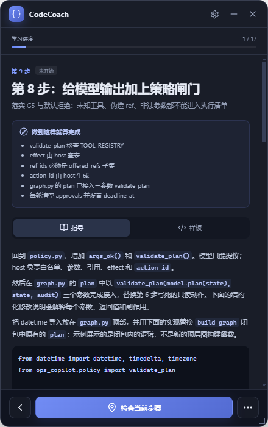
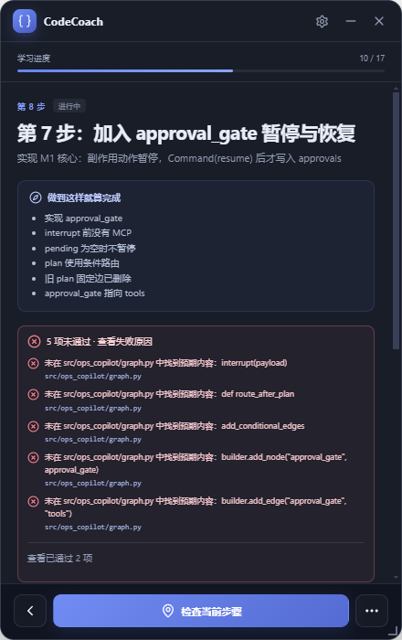

<p align="center">
  
</p>

# CodeCoach

CodeCoach 是一款面向 Windows 的本地编程学习助手：把结构化 Markdown 教程、可验证的练习步骤和桌面置顶浮窗结合起来，帮助新手在自己的编辑器与真实项目中循序渐进地完成代码。

它不替用户自动生成整个项目，而是依次提供行动说明、完成标准、分层提示、最小样板和运行验收证据。当前版本：`0.1.0`。

## 界面预览

| 分步指导与最小样板 | 检查失败原因与通过证据 |
| --- | --- |
|  |  |

## 核心功能

### 置顶学习浮窗

- 浮窗置顶、拖动、缩放、收起和透明度调整，减少编辑器与教程之间的切换。
- 支持鼠标穿透和托盘操作。
- `Ctrl+Alt+Space` 显示或隐藏浮窗，`Ctrl+Alt+P` 切换鼠标穿透。
- 保存学习进度，支持继续学习、重新定位、人工完成和跳过步骤。

### 结构化 Markdown 教程

- 使用版本化的 `coach_version: 1` 协议，普通 Markdown 即可编写教程。
- 每个步骤包含稳定 ID、前置依赖、下一步、完成标准和文件检查规则。
- 支持 `file_exists`、`file_contains` 以及 `all`、`any`、`not` 条件组合。
- 内置协议解析、步骤依赖检查和教程质量 lint，帮助作者发现缺失样板、弱验收和模块路径错误。

### 分层教学与可视化

- 按“行动说明 → 概念提示 → 逐行指导 → 最小完整样板”逐步展开，避免直接给出全部答案。
- 代码默认只提供复制，不自动覆盖用户文件。
- 支持 Mermaid 时序图和流程图，可放大、缩小、重置比例并拖动查看。
- 跨文件修改可通过 `edits` 描述函数契约、参数、返回值和副作用。

### 证据驱动的练习验收

- 文件检查显示具体通过或失败原因，包括目标文件和缺失文本。
- 阶段验收卡片展示真实工作区、参数数组形式的命令和预期输出，并支持一键复制。
- 明确区分离线文件检查与用户手动运行结果，不把“文件存在”描述成“测试通过”。
- 不后台静默执行命令，测试和运行始终由用户在自己的终端中完成。

### 错误定位与诊断插件

- 根据最后一行异常、实际运行目录、验收命令和官方样板使用情况生成修复建议。
- 可识别模块搜索路径、依赖安装、`ToolMessage` 参数、断言失败和 PowerShell 执行策略等常见问题。
- 支持单文件 `.coachdiag` 声明式诊断插件，更新规则无需重新打包应用。
- 插件不能执行 JavaScript、Python、shell、网络请求或任意文件操作；建议命令只展示，不自动运行。

### 本地优先与隐私保护

- 默认不联网，不上传源码、完整环境变量或完整命令历史。
- 错误分析默认只在内存中进行，只有用户主动保存后才写入本机。
- 保存反馈前会脱敏手机号、邮箱、Bearer token 和常见密钥字段，并隐藏本机用户目录前缀。
- 本地最多保留最近 100 条反馈；导出或分享前仍应人工检查。

## 内置示例教程

| 教程 | 学习产出 |
| --- | --- |
| [Express 最小应用实战](examples/express-quickstart.md) | 从空目录创建 Express 服务、路由和 HTTP 监听 |
| [LangChain 新手入门](examples/langchain-quickstart.guide.md) | 实践 LCEL、`create_agent`、工具循环、结构化输出、短期记忆及框架边界 |
| [Ops Copilot（LangGraph）](examples/ops-copilot-langgraph.guide.md) | 完成带持久化、人工审批、策略校验和幂等保护的运维 Agent |

LangChain 核心练习使用确定性的离线假模型，无需 API Key；真实模型接入作为单独的可选步骤，不会把离线测试结果误认为真实模型质量验证。

## 快速开始

### 环境要求

- Windows 10/11 64 位
- Node.js 20+
- npm

### 安装与开发运行

```powershell
git clone https://github.com/Cool-best/codeCoach.git
cd codeCoach
npm ci
npm run dev
```

启动后：

1. 导入 `examples/` 中的教程，或选择自己编写的 `.md` 教程。
2. 选择练习项目根目录。
3. 点击“开始指导”，在自己的编辑器中完成当前步骤。
4. 先运行步骤要求的命令并核对输出，再执行文件检查。

### 构建与打包

```powershell
# 类型检查及主进程、渲染进程构建
npm run build

# 严格检查所有内置教程
npm run guide:lint

# 生成 Windows x64 NSIS 安装包
npm run dist
```

打包结果位于本地 `release/` 目录，该目录不会提交到 Git。

## 常用开发命令

| 命令 | 用途 |
| --- | --- |
| `npm run dev` | 同时启动 Vite 和 Electron 开发环境 |
| `npm run typecheck` | 检查渲染进程和 Electron 主进程 TypeScript 类型 |
| `npm run build` | 完整构建应用 |
| `npm run guide:lint` | 检查全部内置教程 |
| `npm run guide:lint -- --strict <教程路径>` | 严格检查指定教程，警告也视为失败 |
| `npm run diagnostics:pack` | 校验并打包内置诊断插件 |
| `npm run diagnostics:pack -- <插件路径>` | 打包指定诊断插件 |

## 项目结构

```text
electron/                 Electron 主进程与受限 Preload API
src/                      React 用户界面
shared/                   主进程与渲染进程共享类型
examples/                 内置 CodeCoach 教程
resources/diagnostics/    内置声明式诊断插件
scripts/                  教程 lint 和插件打包工具
```

## 当前边界

- 目前面向 Windows，不是通用 AI 编程助手，也不依赖云端账号。
- 文件检查只能证明文件和关键文本存在，不能替代编译、测试或真实业务验收。
- 不自动写入练习代码，不无人值守执行测试或 shell 命令。
- 诊断插件只提供声明式规则，不具备独立执行能力。
- 自动脱敏无法覆盖所有秘密，分享反馈前必须人工复核。

## 文档

- [使用指导](USAGE.md)：学习流程、快捷键、运行验收和错误反馈
- [教程编写与质量规范](GUIDE.md)：教程结构、验收协议和发布质量门
- [诊断插件开发](DIAGNOSTIC_PLUGINS.md)：插件格式、安装、打包和安全边界
- [产品与技术设计](DESIGN.md)：产品范围、架构和协议设计

## 许可证

本项目基于 [MIT License](LICENSE) 开源。第三方组件声明见 [THIRD_PARTY_NOTICES.txt](resources/THIRD_PARTY_NOTICES.txt)。
