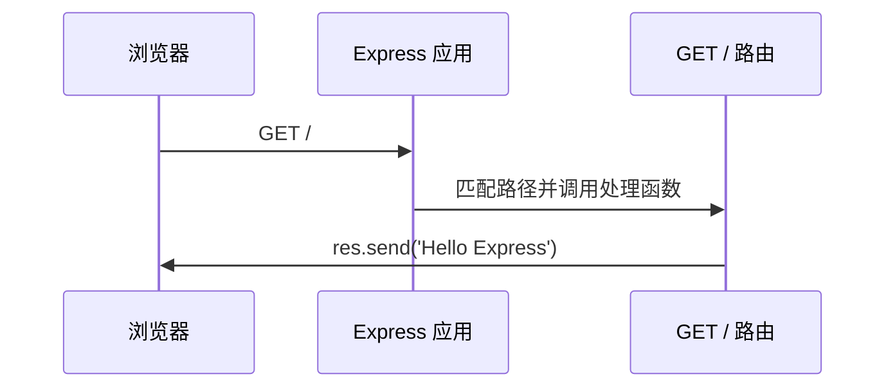
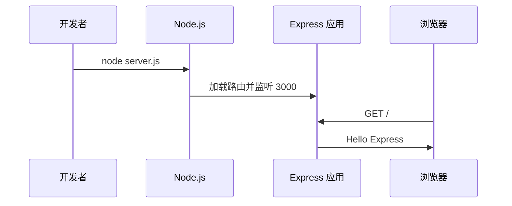

## 准备项目与 Express

在选择的练习目录中初始化 npm 项目并安装 Express。你可以先在自己熟悉的终端中执行 `npm init -y`，再执行 `npm install express`。本教程不会替你运行命令。

```json coach
{
  "id": "prepare",
  "summary": "建立 package.json，并把 Express 加入项目依赖",
  "next": ["create-server"],
  "acceptance": ["package.json 已存在", "依赖声明中包含 express"],
  "completion": {
    "all": [
      { "type": "file_exists", "path": "package.json" },
      { "type": "file_contains", "path": "package.json", "pattern": "\"express\"" }
    ]
  },
  "hints": ["先确认终端当前目录就是练习目录。", "安装成功后，package.json 的 dependencies 中会出现 express。"]
}
```

## 创建应用入口

新建 `server.js`，导入 Express 并创建一个应用实例。此时还不需要写路由。

```json coach
{
  "id": "create-server",
  "summary": "创建 server.js，得到可供后续配置的 app 实例",
  "prerequisites": ["prepare"],
  "next": ["add-route"],
  "acceptance": ["server.js 已存在", "代码调用了 express() 创建应用"],
  "completion": {
    "all": [
      { "type": "file_exists", "path": "server.js" },
      { "type": "file_contains", "path": "server.js", "pattern": "express()" }
    ]
  },
  "hints": ["CommonJS 项目可以使用 require 导入 Express。", "express 是工厂函数，调用后才会得到 app。"],
  "lineMode": [
    { "code": "const express = require('express');", "explanation": "把刚才安装的 Express 包导入当前文件。" },
    { "code": "", "explanation": "留一个空行，让导入和应用代码更容易阅读。" },
    { "code": "const app = express();", "explanation": "创建应用实例，后面的路由和监听都通过它配置。" }
  ]
}
```

```js
const express = require('express');

const app = express();
```

## 添加第一个路由

在 `server.js` 中增加根路径 `/` 的 GET 路由，让浏览器访问时收到一段明确文本。

```json coach
{
  "id": "add-route",
  "summary": "让应用响应 GET / 请求，理解路径与处理函数的关系",
  "prerequisites": ["create-server"],
  "next": ["listen"],
  "acceptance": ["server.js 中存在 app.get 路由", "路由会向客户端发送 Hello Express"],
  "completion": {
    "all": [
      { "type": "file_contains", "path": "server.js", "pattern": "app.get" },
      { "type": "file_contains", "path": "server.js", "pattern": "Hello Express" }
    ]
  },
  "hints": ["app.get 的第一个参数是路径，第二个参数是请求处理函数。", "在处理函数中使用 res.send 返回文本。"],
  "lineMode": [
    { "code": "app.get('/', (req, res) => {", "explanation": "声明根路径的 GET 路由，并接收请求与响应对象。" },
    { "code": "  res.send('Hello Express');", "explanation": "把文本写入响应并发送给浏览器。" },
    { "code": "});", "explanation": "结束处理函数和路由声明。" }
  ],
  "diagram": { "sourceId": "request-flow", "highlightMessages": [1, 2] }
}
```

```js
app.get('/', (req, res) => {
  res.send('Hello Express');
});
```



## 启动 HTTP 监听

在文件末尾调用 `app.listen`，让应用监听本机 3000 端口。保存后，检查器会通过时进入完成状态。

```json coach
{
  "id": "listen",
  "summary": "监听 3000 端口，形成从创建应用到响应请求的完整链路",
  "prerequisites": ["add-route"],
  "next": [],
  "acceptance": ["server.js 调用 app.listen", "代码指定 3000 端口"],
  "completion": {
    "all": [
      { "type": "file_contains", "path": "server.js", "pattern": "app.listen" },
      { "type": "file_contains", "path": "server.js", "pattern": "3000" }
    ]
  },
  "hints": ["把端口作为 app.listen 的第一个参数。", "可以在回调中输出访问地址，方便自己确认服务已启动。"],
  "lineMode": [
    { "code": "app.listen(3000, () => {", "explanation": "监听 3000 端口，并在就绪后调用回调。" },
    { "code": "  console.log('Open http://localhost:3000');", "explanation": "在终端显示可以访问的地址。" },
    { "code": "});", "explanation": "完成启动代码。" }
  ],
  "diagram": { "sourceId": "complete-flow", "highlightMessages": [4] }
}
```

```js
app.listen(3000, () => {
  console.log('Open http://localhost:3000');
});
```



最后由你在终端执行 `node server.js`，再访问 `http://localhost:3000` 做真实运行验收。当前 MVP 只验证文件内容，不会把文件检查描述成测试已通过。
