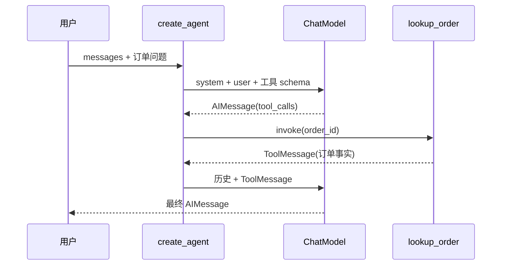
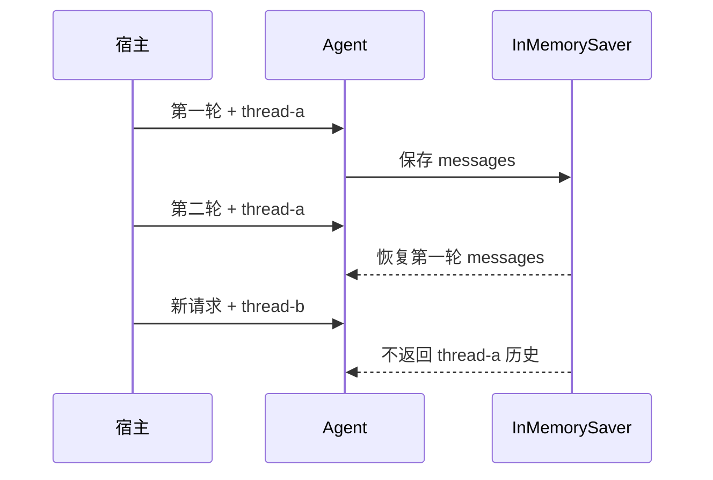
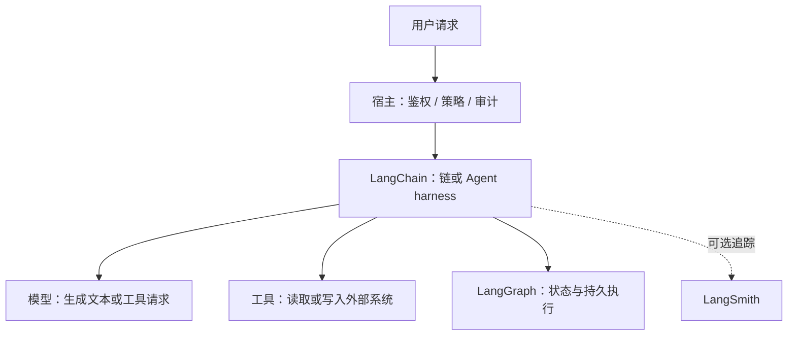

本教程使用 Python 3.11+ 和 LangChain v1。你会完成一个订单问答项目：先写普通链，再让 Agent 调用只读工具，最后加入结构化输出和线程级短期记忆。

核心练习使用脚本化假模型，因此不需要 API Key，输出也不会随机变化。假模型只替代外部模型应答；链、Agent、工具执行、状态保存都由真实 LangChain/LangGraph 代码完成。最后可以把同一套业务代码接到真实模型。

准备：Windows、Python 3.11+、VS Code 或任意编辑器。命令都由你在项目根目录手动执行；CodeCoach 不会替你安装依赖或运行测试。**文件检查通过不等于测试通过，更不等于真实模型质量已经通过。**

## 第 1 步：建立 Python 项目

新建 `pyproject.toml`、`src/langchain_start/__init__.py` 和 `tests/`。`__init__.py` 可以是空文件。依赖固定在主要版本范围内，既获得 v1 更新，也避免无意跨大版本升级。

```json coach
{
  "id": "prepare-project",
  "summary": "建立 src 布局并声明 LangChain v1、LangGraph、Pydantic 与 pytest 依赖",
  "next": ["first-chain"],
  "acceptance": ["pyproject.toml 存在", "声明 langchain 和 langgraph", "声明 pytest 开发依赖", "langchain_start 包存在"],
  "completion": {
    "all": [
      { "type": "file_exists", "path": "pyproject.toml" },
      { "type": "file_contains", "path": "pyproject.toml", "pattern": "langchain>=1.0,<2" },
      { "type": "file_contains", "path": "pyproject.toml", "pattern": "langgraph>=1.0,<2" },
      { "type": "file_contains", "path": "pyproject.toml", "pattern": "pytest" },
      { "type": "file_exists", "path": "src/langchain_start/__init__.py" }
    ]
  },
  "hints": ["先确认 python --version 不低于 3.11。", "PowerShell 激活虚拟环境后，python -m pip 会使用该环境中的 pip。"],
  "lineMode": [
    { "code": "requires-python = \">=3.11\"", "explanation": "明确项目使用的最低 Python 版本。" },
    { "code": "pythonpath = [\"src\"]", "explanation": "让 pytest 能从 src 布局导入项目包。" }
  ]
}
```

```toml
[build-system]
requires = ["setuptools>=68"]
build-backend = "setuptools.build_meta"

[project]
name = "langchain-start"
version = "0.1.0"
requires-python = ">=3.11"
dependencies = [
  "langchain>=1.0,<2",
  "langgraph>=1.0,<2",
  "pydantic>=2.7,<3",
]

[project.optional-dependencies]
dev = ["pytest>=8,<10"]
real = ["langchain-openai>=1.0,<2"]

[tool.pytest.ini_options]
pythonpath = ["src"]
testpaths = ["tests"]
```

在终端执行：

```powershell
python --version
python -m venv .venv
.venv\Scripts\Activate.ps1
python -m pip install -e ".[dev]"
```

如果 PowerShell 阻止激活脚本，可在当前终端执行 `Set-ExecutionPolicy -Scope Process Bypass`，再运行激活命令；不要修改系统级策略。

## 第 2 步：运行第一条 LCEL 链

新建 `src/langchain_start/chain.py`。LCEL 用 `|` 把多个 Runnable 串起来：提示词模板接收字典并生成消息，模型返回 `AIMessage`，字符串解析器取出文本。

这里使用 LangChain 自带的 `FakeListChatModel` 返回固定文本。它让练习离线且确定，但业务代码仍然走真实的 `chain.invoke()`。

```json coach
{
  "id": "first-chain",
  "summary": "组合提示词、聊天模型和输出解析器，理解普通链只执行定义好的数据流",
  "prerequisites": ["prepare-project"],
  "next": ["tools-and-fake-model"],
  "acceptance": ["chain.py 使用 ChatPromptTemplate", "使用 LCEL 管道和 StrOutputParser", "demo_chain.py 真实调用 chain.invoke", "终端显示 CHAIN PASS（需你运行确认）"],
  "completion": {
    "all": [
      { "type": "file_exists", "path": "src/langchain_start/chain.py" },
      { "type": "file_contains", "path": "src/langchain_start/chain.py", "pattern": "ChatPromptTemplate" },
      { "type": "file_contains", "path": "src/langchain_start/chain.py", "pattern": "prompt | model | StrOutputParser()" },
      { "type": "file_exists", "path": "src/langchain_start/demo_chain.py" },
      { "type": "file_contains", "path": "src/langchain_start/demo_chain.py", "pattern": "chain.invoke" },
      { "type": "file_contains", "path": "src/langchain_start/demo_chain.py", "pattern": "CHAIN PASS" },
      { "type": "file_contains", "path": "src/langchain_start/demo_chain.py", "pattern": "__main__" }
    ]
  },
  "edits": [
    {
      "path": "src/langchain_start/chain.py",
      "summary": "创建可注入模型的提示词到文本链。",
      "instructions": ["定义 build_chain，默认使用固定回答的假模型。", "用管道依次连接提示词、模型和字符串解析器。"],
      "functions": [
        {
          "name": "build_chain",
          "signature": "build_chain(model=None)",
          "purpose": "构造把 product 和 audience 转换为一句中文介绍的链。",
          "parameters": [{ "name": "model", "type": "BaseChatModel | None", "description": "可替换的聊天模型；缺省时使用离线假模型。" }],
          "returns": "可调用 invoke 的 Runnable 链。",
          "sideEffects": "调用时才会执行模型；构建链本身不请求网络。"
        }
      ],
      "requiredPatterns": ["ChatPromptTemplate", "prompt | model | StrOutputParser()"]
    },
    {
      "path": "src/langchain_start/demo_chain.py",
      "summary": "提供真实执行链并断言结果的验收入口。",
      "instructions": ["构造链，传入两个模板变量并调用 invoke。", "断言固定输出后再打印 CHAIN PASS。"],
      "functions": [
        {
          "name": "main",
          "signature": "main() -> None",
          "purpose": "验证链的完整调用路径。",
          "parameters": [],
          "returns": "无；断言失败会抛出异常。",
          "sideEffects": "执行链并向终端打印结果。"
        }
      ],
      "requiredPatterns": ["chain.invoke", "CHAIN PASS", "__main__"]
    }
  ],
  "verification": {
    "cwd": ".",
    "command": ["python", "-m", "langchain_start.demo_chain"],
    "moduleFile": "src/langchain_start/demo_chain.py",
    "expectedOutput": "CHAIN PASS",
    "manual": true
  },
  "hints": ["模板变量名必须与 invoke 字典的键一致。", "如果输出不是预期文本，先检查 FakeListChatModel 的 responses。"],
  "lineMode": [
    { "code": "prompt = ChatPromptTemplate.from_messages([...])", "explanation": "把 system 规则和 user 输入组织成模型消息。" },
    { "code": "return prompt | model | StrOutputParser()", "explanation": "前一个 Runnable 的输出成为后一个的输入。" }
  ],
  "diagram": { "sourceId": "chain-flow", "highlightMessages": [1, 2, 3] }
}
```

```python
from langchain_core.language_models.fake_chat_models import FakeListChatModel
from langchain_core.output_parsers import StrOutputParser
from langchain_core.prompts import ChatPromptTemplate


def build_chain(model=None):
    model = model or FakeListChatModel(responses=["LangChain 帮开发者组合模型与应用逻辑。"])
    prompt = ChatPromptTemplate.from_messages([
        ("system", "用一句中文向{audience}介绍产品，不要补充未提供的事实。"),
        ("user", "产品能力：{product}"),
    ])
    return prompt | model | StrOutputParser()
```

再新建 `src/langchain_start/demo_chain.py`：

```python
from langchain_start.chain import build_chain


def main():
    chain = build_chain()
    result = chain.invoke({
        "product": "统一模型接口、链和 Agent 工具循环",
        "audience": "Python 初学者",
    })
    assert result == "LangChain 帮开发者组合模型与应用逻辑。"
    print(f"CHAIN PASS | {result}")


if __name__ == "__main__":
    main()
```

在项目根目录运行 `python -m langchain_start.demo_chain`，看到 `CHAIN PASS` 才算通过。

**边界**：这条链没有自主决策循环，不会因为你提到“订单”就调用工具。它只执行你写出的提示词 → 模型 → 解析器路径；模型是否遵守提示词也不是确定性保证。


## 第 3 步：准备只读工具和脚本化模型

Agent 需要一个能返回工具调用的模型。真实模型会根据消息决定是否调用；本教程的 `ScriptedChatModel` 按脚本返回 `AIMessage`，以便精确验证 LangChain 的 Agent 循环。

新建 `src/langchain_start/fake_model.py`。`bind_tools()` 返回自身，表示测试替身接受工具绑定；`_generate()` 记录每次模型实际看到的消息，并依次返回脚本应答。不要把这个测试替身当成模型能力演示，它只负责让测试确定。

```json coach
{
  "id": "tools-and-fake-model",
  "summary": "实现只读订单工具和可记录输入的脚本化聊天模型，为离线 Agent 验收做准备",
  "prerequisites": ["first-chain"],
  "next": ["tool-agent"],
  "acceptance": ["lookup_order 使用 @tool", "未知订单返回 found=False", "假模型支持 bind_tools", "假模型真实记录 messages"],
  "completion": {
    "all": [
      { "type": "file_exists", "path": "src/langchain_start/orders.py" },
      { "type": "file_contains", "path": "src/langchain_start/orders.py", "pattern": "@tool" },
      { "type": "file_contains", "path": "src/langchain_start/orders.py", "pattern": "def lookup_order" },
      { "type": "file_contains", "path": "src/langchain_start/orders.py", "pattern": "\"found\": False" },
      { "type": "file_exists", "path": "src/langchain_start/fake_model.py" },
      { "type": "file_contains", "path": "src/langchain_start/fake_model.py", "pattern": "class ScriptedChatModel" },
      { "type": "file_contains", "path": "src/langchain_start/fake_model.py", "pattern": "def bind_tools" },
      { "type": "file_contains", "path": "src/langchain_start/fake_model.py", "pattern": "self.calls.append(list(messages))" },
      { "type": "file_contains", "path": "src/langchain_start/fake_model.py", "pattern": "ChatResult" }
    ]
  },
  "edits": [
    {
      "path": "src/langchain_start/orders.py",
      "summary": "用本地白名单数据实现只读订单查询。",
      "instructions": ["定义固定订单字典和 @tool 函数。", "命中时返回订单副本，未命中时明确返回 found=False。"],
      "functions": [
        {
          "name": "lookup_order",
          "signature": "lookup_order(order_id: str) -> dict",
          "purpose": "向 Agent 提供确定、只读的订单事实。",
          "parameters": [{ "name": "order_id", "type": "str", "description": "要查询的订单号。" }],
          "returns": "包含 found 和订单状态的字典。",
          "sideEffects": "无；不访问网络，不修改订单。"
        }
      ],
      "requiredPatterns": ["@tool", "def lookup_order", "\"found\": False"]
    },
    {
      "path": "src/langchain_start/fake_model.py",
      "summary": "实现 LangChain BaseChatModel 测试替身。",
      "instructions": ["保存 AIMessage 应答脚本并记录模型调用输入。", "bind_tools 返回自身，_generate 返回 ChatResult。"],
      "functions": [
        {
          "name": "_generate",
          "signature": "_generate(messages, stop=None, run_manager=None, **kwargs) -> ChatResult",
          "purpose": "按脚本产生模型消息并保留真实输入供测试断言。",
          "parameters": [{ "name": "messages", "type": "list[BaseMessage]", "description": "Agent 实际发给模型的完整消息。" }],
          "returns": "包含下一条脚本 AIMessage 的 ChatResult。",
          "sideEffects": "追加调用记录并推进脚本下标；不访问网络。"
        }
      ],
      "requiredPatterns": ["class ScriptedChatModel", "def bind_tools", "self.calls.append(list(messages))", "ChatResult"]
    }
  ],
  "hints": ["工具 docstring 会成为模型选择工具时看到的说明，不要省略。", "tool_calls 每项都需要 name、args、id 和 type，后续步骤会用到。"],
  "lineMode": [
    { "code": "class ScriptedChatModel(BaseChatModel):", "explanation": "接入 LangChain 的统一聊天模型接口。" },
    { "code": "self.calls.append(list(messages))", "explanation": "保存 Agent 发来的消息，之后可以验证工具结果和历史是否进入模型上下文。" }
  ]
}
```

```python
from langchain_core.language_models.chat_models import BaseChatModel
from langchain_core.messages import BaseMessage
from langchain_core.outputs import ChatGeneration, ChatResult
from pydantic import Field, PrivateAttr


class ScriptedChatModel(BaseChatModel):
    responses: list
    calls: list[list[BaseMessage]] = Field(default_factory=list)
    _index: int = PrivateAttr(default=0)

    @property
    def _llm_type(self) -> str:
        return "scripted"

    def bind_tools(self, tools, **kwargs):
        return self

    def _generate(self, messages, stop=None, run_manager=None, **kwargs):
        self.calls.append(list(messages))
        index = min(self._index, len(self.responses) - 1)
        response = self.responses[index]
        self._index += 1
        return ChatResult(generations=[ChatGeneration(message=response)])
```

新建 `src/langchain_start/orders.py`：

```python
from langchain_core.tools import tool

ORDERS = {
    "A-100": {"order_id": "A-100", "status": "shipped", "progress": 80},
}


@tool
def lookup_order(order_id: str) -> dict:
    """按订单号查询只读订单状态；没有记录时返回 found=False。"""
    order = ORDERS.get(order_id)
    if order is None:
        return {"found": False, "order_id": order_id}
    return {"found": True, **order}
```

工具描述和类型标注会生成工具 schema，但 **schema 不是权限系统**。真实应用仍须在宿主或工具内部做鉴权、参数校验、审计和写操作审批。

## 第 4 步：让 create_agent 完成工具循环

新建 `src/langchain_start/agent.py`。脚本第一轮返回 `lookup_order` 工具请求，第二轮返回最终文本。`create_agent` 负责执行中间循环，你不需要手写 `for` 来调用工具或拼 `ToolMessage`。

```json coach
{
  "id": "tool-agent",
  "summary": "用 create_agent 串联模型工具请求、真实工具执行、ToolMessage 和最终回答",
  "prerequisites": ["tools-and-fake-model"],
  "next": ["structured-output"],
  "acceptance": ["agent.py 使用 create_agent", "lookup_order 注册到 tools", "demo 真实调用 agent.invoke", "断言 ToolMessage 和最终答案", "终端显示 AGENT PASS（需你运行确认）"],
  "completion": {
    "all": [
      { "type": "file_exists", "path": "src/langchain_start/agent.py" },
      { "type": "file_contains", "path": "src/langchain_start/agent.py", "pattern": "create_agent" },
      { "type": "file_contains", "path": "src/langchain_start/agent.py", "pattern": "tools=[lookup_order]" },
      { "type": "file_contains", "path": "src/langchain_start/agent.py", "pattern": "agent.invoke" },
      { "type": "file_contains", "path": "src/langchain_start/agent.py", "pattern": "ToolMessage" },
      { "type": "file_contains", "path": "src/langchain_start/agent.py", "pattern": "AGENT PASS" }
    ]
  },
  "edits": [
    {
      "path": "src/langchain_start/agent.py",
      "summary": "创建只读订单 Agent 和离线验收入口。",
      "instructions": ["build_order_agent 接收模型并注册订单工具。", "make_scripted_model 先发起工具调用，再返回自然语言答案。", "main 调用 Agent 并检查消息轨迹。"],
      "functions": [
        {
          "name": "build_order_agent",
          "signature": "build_order_agent(model)",
          "purpose": "构造带只读订单工具的 LangChain Agent。",
          "parameters": [{ "name": "model", "type": "BaseChatModel", "description": "支持工具调用的真实或脚本化聊天模型。" }],
          "returns": "可用 messages 输入调用 invoke 的 Agent。",
          "sideEffects": "调用时可能执行模型和订单工具。"
        },
        {
          "name": "main",
          "signature": "main() -> None",
          "purpose": "验证工具循环而不只检查函数存在。",
          "parameters": [],
          "returns": "无。",
          "sideEffects": "执行 Agent、工具并打印 AGENT PASS。"
        }
      ],
      "requiredPatterns": ["create_agent", "tools=[lookup_order]", "agent.invoke", "ToolMessage", "AGENT PASS"]
    }
  ],
  "verification": {
    "cwd": ".",
    "command": ["python", "-m", "langchain_start.agent"],
    "moduleFile": "src/langchain_start/agent.py",
    "expectedOutput": "AGENT PASS",
    "manual": true
  },
  "hints": ["第二轮模型输入应包含 ToolMessage；可打印 message.type 观察轨迹。", "若模型反复请求工具，检查脚本第二条是否返回不带 tool_calls 的 AIMessage。"],
  "lineMode": [
    { "code": "agent = create_agent(model=model, tools=[lookup_order], system_prompt=...)", "explanation": "把模型、工具和系统规则组装成 Agent harness。" },
    { "code": "result = agent.invoke({\"messages\": [...]})", "explanation": "启动模型—工具循环，直到模型给出最终回答。" }
  ],
  "diagram": { "sourceId": "agent-loop", "highlightMessages": [1, 2, 3, 4, 5] }
}
```

```python
from langchain.agents import create_agent
from langchain_core.messages import AIMessage, ToolMessage
from langchain_start.fake_model import ScriptedChatModel
from langchain_start.orders import lookup_order


def build_order_agent(model):
    return create_agent(
        model=model,
        tools=[lookup_order],
        system_prompt="回答订单问题前先查询工具；只能依据工具结果陈述订单事实。",
    )


def make_scripted_model():
    return ScriptedChatModel(responses=[
        AIMessage(content="", tool_calls=[{
            "name": "lookup_order",
            "args": {"order_id": "A-100"},
            "id": "call-order-1",
            "type": "tool_call",
        }]),
        AIMessage(content="订单 A-100 已发货，当前进度为 80%。"),
    ])


def main():
    agent = build_order_agent(make_scripted_model())
    result = agent.invoke({
        "messages": [{"role": "user", "content": "订单 A-100 现在怎么样？"}],
    })
    tool_messages = [m for m in result["messages"] if isinstance(m, ToolMessage)]
    assert len(tool_messages) == 1
    assert tool_messages[0].tool_call_id == "call-order-1"
    assert result["messages"][-1].text == "订单 A-100 已发货，当前进度为 80%。"
    print("AGENT PASS | tool_calls=1 | final_answer=ok")


if __name__ == "__main__":
    main()
```

运行 `python -m langchain_start.agent`，预期看到 `AGENT PASS | tool_calls=1 | final_answer=ok`。

注意：模型返回 `tool_calls` 只是**请求**；Agent harness 才执行工具并把结果加入消息。生产系统不能让模型自行声明“已获授权”，也不能把工具白名单当成完整安全边界。



## 第 5 步：把最终回答变成结构化输出

业务程序通常需要字段，而不是一段自然语言。修改 `agent.py`：增加 `OrderReport`，把 `response_format=ToolStrategy(OrderReport)` 传给 `create_agent`，并让脚本第二轮请求结构化输出工具。

`structured_response` 是经过 Pydantic 校验的对象。`Literal` 限定状态枚举，`Field(ge=0, le=100)` 限定进度范围。

```json coach
{
  "id": "structured-output",
  "summary": "通过 response_format 返回 Pydantic 对象，同时区分结构合法与事实正确",
  "prerequisites": ["tool-agent"],
  "next": ["thread-memory"],
  "acceptance": ["定义 OrderReport", "status 使用 Literal", "progress 限制 0 到 100", "create_agent 使用 ToolStrategy", "断言 structured_response"],
  "completion": {
    "all": [
      { "type": "file_contains", "path": "src/langchain_start/agent.py", "pattern": "class OrderReport" },
      { "type": "file_contains", "path": "src/langchain_start/agent.py", "pattern": "Literal" },
      { "type": "file_contains", "path": "src/langchain_start/agent.py", "pattern": "ge=0, le=100" },
      { "type": "file_contains", "path": "src/langchain_start/agent.py", "pattern": "response_format=ToolStrategy(OrderReport)" },
      { "type": "file_contains", "path": "src/langchain_start/agent.py", "pattern": "structured_response" }
    ]
  },
  "edits": [
    {
      "path": "src/langchain_start/agent.py",
      "summary": "把自然语言最终响应替换为经过校验的订单报告。",
      "instructions": ["新增 OrderReport 并配置 ToolStrategy。", "脚本第二次调用改为 OrderReport 工具请求。", "断言 structured_response 的字段，而不是最后一条文本。"],
      "functions": [
        {
          "name": "build_order_agent",
          "signature": "build_order_agent(model)",
          "purpose": "构造同时支持只读工具和结构化响应的 Agent。",
          "parameters": [{ "name": "model", "type": "BaseChatModel", "description": "支持工具调用的模型。" }],
          "returns": "最终状态包含 structured_response 的 Agent。",
          "sideEffects": "调用时执行模型和工具。"
        }
      ],
      "requiredPatterns": ["class OrderReport", "Literal", "ge=0, le=100", "response_format=ToolStrategy(OrderReport)", "structured_response"]
    }
  ],
  "hints": ["显式使用 ToolStrategy 可以让离线模型路径保持一致；真实模型也可按提供商能力选择 ProviderStrategy。", "结构化输出工具的 name 必须与 Pydantic 类名 OrderReport 一致。"],
  "lineMode": [
    { "code": "response_format=ToolStrategy(OrderReport)", "explanation": "要求 Agent 用工具调用策略生成并校验最终结构。" },
    { "code": "report = result[\"structured_response\"]", "explanation": "读取 Pydantic 对象，不再自行解析自然语言 JSON。" }
  ]
}
```

下面是完整的 `agent.py`，用它替换上一版：

```python
from typing import Literal
from langchain.agents import create_agent
from langchain.agents.structured_output import ToolStrategy
from langchain_core.messages import AIMessage, ToolMessage
from pydantic import BaseModel, Field
from langchain_start.fake_model import ScriptedChatModel
from langchain_start.orders import lookup_order


class OrderReport(BaseModel):
    """依据订单工具结果生成的状态报告。"""
    order_id: str = Field(description="订单号")
    status: Literal["pending", "shipped", "delivered"]
    progress: int = Field(ge=0, le=100, description="履约进度百分比")


def build_order_agent(model):
    return create_agent(
        model=model,
        tools=[lookup_order],
        system_prompt="回答订单问题前先查询工具；只能依据工具结果填写报告。",
        response_format=ToolStrategy(OrderReport),
    )


def make_scripted_model():
    return ScriptedChatModel(responses=[
        AIMessage(content="", tool_calls=[{
            "name": "lookup_order",
            "args": {"order_id": "A-100"},
            "id": "call-order-1",
            "type": "tool_call",
        }]),
        AIMessage(content="", tool_calls=[{
            "name": "OrderReport",
            "args": {"order_id": "A-100", "status": "shipped", "progress": 80},
            "id": "call-report-1",
            "type": "tool_call",
        }]),
    ])


def main():
    agent = build_order_agent(make_scripted_model())
    result = agent.invoke({
        "messages": [{"role": "user", "content": "订单 A-100 现在怎么样？"}],
    })
    tool_messages = [m for m in result["messages"] if isinstance(m, ToolMessage)]
    assert any(m.tool_call_id == "call-order-1" for m in tool_messages)
    report = result["structured_response"]
    assert isinstance(report, OrderReport)
    assert report.order_id == "A-100"
    assert report.status == "shipped"
    assert report.progress == 80
    print("AGENT PASS | tool_calls=1 | structured_response=ok")


if __name__ == "__main__":
    main()
```

再次运行 `python -m langchain_start.agent`，预期看到 `AGENT PASS | tool_calls=1 | structured_response=ok`。

**边界**：`progress=80` 合法，不代表它一定来自真实订单；模型完全可能生成一个形状正确但内容错误的值。Pydantic 校验字段，业务事实仍要由工具结果、来源引用和应用断言核对。真实模型还必须支持相应的结构化输出或工具调用能力。

## 第 6 步：验证线程级短期记忆

新建 `src/langchain_start/memory.py`。`InMemorySaver` 按 `thread_id` 保存 Agent 状态。第二次调用同一线程时，模型输入应包含第一轮历史；换一个线程则不应看到它。

测试不是看假模型“自称记得”，而是直接断言 `model.calls` 中第二次调用的真实消息列表。

```json coach
{
  "id": "thread-memory",
  "summary": "用 InMemorySaver 和 thread_id 验证同线程历史恢复与不同线程隔离",
  "prerequisites": ["structured-output"],
  "next": ["real-model"],
  "acceptance": ["create_agent 配置 InMemorySaver", "两轮调用使用相同 thread_id", "断言第二次模型输入含首轮历史", "断言新线程没有旧昵称", "终端显示 MEMORY PASS（需你运行确认）"],
  "completion": {
    "all": [
      { "type": "file_exists", "path": "src/langchain_start/memory.py" },
      { "type": "file_contains", "path": "src/langchain_start/memory.py", "pattern": "InMemorySaver" },
      { "type": "file_contains", "path": "src/langchain_start/memory.py", "pattern": "thread-a" },
      { "type": "file_contains", "path": "src/langchain_start/memory.py", "pattern": "thread-b" },
      { "type": "file_contains", "path": "src/langchain_start/memory.py", "pattern": "model.calls[1]" },
      { "type": "file_contains", "path": "src/langchain_start/memory.py", "pattern": "MEMORY PASS" }
    ]
  },
  "edits": [
    {
      "path": "src/langchain_start/memory.py",
      "summary": "创建带内存 checkpointer 的 Agent 并验证真实上下文。",
      "instructions": ["build_memory_agent 注入 InMemorySaver。", "同线程调用两次，再在新线程调用一次。", "通过模型输入历史证明记忆与隔离。"],
      "functions": [
        {
          "name": "main",
          "signature": "main() -> None",
          "purpose": "验证线程历史恢复和线程隔离。",
          "parameters": [],
          "returns": "无。",
          "sideEffects": "在进程内保存检查点、执行 Agent 并打印 MEMORY PASS。"
        }
      ],
      "requiredPatterns": ["InMemorySaver", "thread-a", "thread-b", "model.calls[1]", "MEMORY PASS"]
    }
  ],
  "verification": {
    "cwd": ".",
    "command": ["python", "-m", "langchain_start.memory"],
    "moduleFile": "src/langchain_start/memory.py",
    "expectedOutput": "MEMORY PASS",
    "manual": true
  },
  "hints": ["config 的形状是 {'configurable': {'thread_id': 'thread-a'}}。", "同一线程的第二次调用应使用同一个 agent 和 config。"],
  "lineMode": [
    { "code": "checkpointer=InMemorySaver()", "explanation": "在进程内保存每个 thread 的 Agent 状态。" },
    { "code": "second_call = model.calls[1]", "explanation": "直接检查模型实际收到的历史，而不是相信回答文本。" }
  ],
  "diagram": { "sourceId": "memory-flow", "highlightMessages": [1, 2, 3, 4] }
}
```

```python
from langchain.agents import create_agent
from langchain_core.messages import AIMessage
from langgraph.checkpoint.memory import InMemorySaver
from langchain_start.fake_model import ScriptedChatModel


def build_memory_agent(model):
    return create_agent(
        model=model,
        tools=[],
        system_prompt="根据当前线程的对话历史回答，不知道时不要猜测。",
        checkpointer=InMemorySaver(),
    )


def main():
    model = ScriptedChatModel(responses=[
        AIMessage(content="已记住昵称。"),
        AIMessage(content="你的昵称是小林。"),
        AIMessage(content="当前线程没有提供昵称。"),
    ])
    agent = build_memory_agent(model)
    config_a = {"configurable": {"thread_id": "thread-a"}}
    config_b = {"configurable": {"thread_id": "thread-b"}}

    agent.invoke({"messages": [{"role": "user", "content": "我的昵称是小林。"}]}, config_a)
    agent.invoke({"messages": [{"role": "user", "content": "我的昵称是什么？"}]}, config_a)
    second_call = model.calls[1]
    assert any(m.text == "我的昵称是小林。" for m in second_call)
    assert any(m.text == "已记住昵称。" for m in second_call)

    agent.invoke({"messages": [{"role": "user", "content": "我的昵称是什么？"}]}, config_b)
    new_thread_call = model.calls[2]
    assert all("小林" not in m.text for m in new_thread_call)
    assert all("已记住昵称" not in m.text for m in new_thread_call)
    print("MEMORY PASS | same_thread=history | new_thread=isolated")


if __name__ == "__main__":
    main()
```

运行 `python -m langchain_start.memory`，预期看到 `MEMORY PASS | same_thread=history | new_thread=isolated`。

**边界**：不配置 checkpointer 时，不会自动获得这种跨调用历史；`InMemorySaver` 在进程重启后丢失。生产持久化需要数据库 checkpointer，长期用户偏好还需要独立的数据与检索设计。完整历史还会增加 token 成本并受上下文窗口限制，需要裁剪、摘要或其他中间件。



## 第 7 步：可选接入真实模型

离线测试证明的是应用编排和断言，不证明某个真实模型会正确选择工具。现在新增 `src/langchain_start/real_model.py`，用 `init_chat_model` 做最小真实调用。此步需要你自己选择受支持的提供商、安装对应集成包并准备凭据；没有凭据时可以跳过运行，但不能把它记为已验证。

```json coach
{
  "id": "real-model",
  "summary": "通过环境变量和 init_chat_model 替换模型提供方，不改变链与 Agent 的业务接口",
  "prerequisites": ["thread-memory"],
  "next": ["final-acceptance"],
  "acceptance": ["real_model.py 使用 init_chat_model", "模型名读取 LANGCHAIN_MODEL", "密钥不写入源码", "真实调用仅作为可选手动验收"],
  "completion": {
    "all": [
      { "type": "file_exists", "path": "src/langchain_start/real_model.py" },
      { "type": "file_contains", "path": "src/langchain_start/real_model.py", "pattern": "init_chat_model" },
      { "type": "file_contains", "path": "src/langchain_start/real_model.py", "pattern": "LANGCHAIN_MODEL" },
      { "type": "file_contains", "path": "src/langchain_start/real_model.py", "pattern": "model.invoke" },
      { "type": "file_contains", "path": "src/langchain_start/real_model.py", "pattern": "REAL MODEL PASS" }
    ]
  },
  "edits": [
    {
      "path": "src/langchain_start/real_model.py",
      "summary": "提供环境变量配置的真实模型冒烟入口。",
      "instructions": ["读取 LANGCHAIN_MODEL，缺失时给出明确提示。", "初始化模型，执行一次真实 invoke 并检查非空文本。"],
      "functions": [
        {
          "name": "main",
          "signature": "main() -> None",
          "purpose": "验证当前提供商配置和网络调用。",
          "parameters": [],
          "returns": "无。",
          "sideEffects": "读取环境变量并向外部模型提供商发送一次请求。"
        }
      ],
      "requiredPatterns": ["init_chat_model", "LANGCHAIN_MODEL", "model.invoke", "REAL MODEL PASS"]
    }
  ],
  "hints": ["OpenAI 示例先安装 .[real]，再按提供商文档设置 OPENAI_API_KEY。", "401 先查凭据，404 先查模型名，429 查额度或限流；不要把密钥贴到教程或反馈报告中。"],
  "lineMode": [
    { "code": "model = init_chat_model(model_name, temperature=0, timeout=60)", "explanation": "通过统一接口初始化指定提供商和模型。" },
    { "code": "response = model.invoke(...)", "explanation": "真实网络调用可能失败或产生费用，与离线假模型不同。" }
  ]
}
```

```python
import os
from langchain.chat_models import init_chat_model


def main():
    model_name = os.environ.get("LANGCHAIN_MODEL")
    if not model_name:
        raise SystemExit("请先设置 LANGCHAIN_MODEL，例如 openai:gpt-5.5")
    model = init_chat_model(model_name, temperature=0, timeout=60)
    response = model.invoke([
        {"role": "system", "content": "用一句中文回答。"},
        {"role": "user", "content": "说明 LangChain 的统一模型接口有什么作用。"},
    ])
    assert response.text.strip(), "模型返回了空文本"
    print(f"REAL MODEL PASS | {response.text}")


if __name__ == "__main__":
    main()
```

OpenAI 示例（其他提供商应安装自己的集成包并使用其环境变量）：

```powershell
python -m pip install -e ".[real]"
$env:LANGCHAIN_MODEL = "openai:gpt-5.5"
```

再按提供商文档在当前终端安全设置 `OPENAI_API_KEY`，运行 `python -m langchain_start.real_model`。看到 `REAL MODEL PASS` 只说明这次基本调用成功，不证明工具选择、事实性或所有提示都可靠。真实调用会产生网络外发、延迟、费用、限流和数据治理问题。

## 第 8 步：运行全量验收并理解边界

新建 `src/langchain_start/demo.py` 汇总三个离线入口，再新建 `tests/test_quickstart.py` 覆盖链、工具循环、未知订单、schema 拒绝和线程隔离。

```json coach
{
  "id": "final-acceptance",
  "summary": "用真实 LangChain 调用和 pytest 完成离线验收，并明确框架不能替代的生产职责",
  "prerequisites": ["real-model"],
  "next": [],
  "acceptance": ["demo.py 汇总链、Agent 和记忆入口", "测试覆盖结构化输出和未知订单", "终端显示 LANGCHAIN PASS（需你运行确认）", "全量 pytest 通过（需你运行确认）"],
  "completion": {
    "all": [
      { "type": "file_exists", "path": "src/langchain_start/demo.py" },
      { "type": "file_contains", "path": "src/langchain_start/demo.py", "pattern": "def main" },
      { "type": "file_contains", "path": "src/langchain_start/demo.py", "pattern": "LANGCHAIN PASS" },
      { "type": "file_contains", "path": "src/langchain_start/demo.py", "pattern": "__main__" },
      { "type": "file_exists", "path": "tests/test_quickstart.py" },
      { "type": "file_contains", "path": "tests/test_quickstart.py", "pattern": "structured_response" },
      { "type": "file_contains", "path": "tests/test_quickstart.py", "pattern": "ValidationError" },
      { "type": "file_contains", "path": "tests/test_quickstart.py", "pattern": "test_unknown_order" },
      { "type": "file_contains", "path": "tests/test_quickstart.py", "pattern": "memory_main" }
    ]
  },
  "edits": [
    {
      "path": "src/langchain_start/demo.py",
      "summary": "汇总所有离线冒烟入口。",
      "instructions": ["依次调用链、订单 Agent 和记忆 main，全部成功后打印总通过标志。"],
      "functions": [
        {
          "name": "main",
          "signature": "main() -> None",
          "purpose": "用一个命令完成核心离线验收。",
          "parameters": [],
          "returns": "无。",
          "sideEffects": "执行离线 demo 并打印结果。"
        }
      ],
      "requiredPatterns": ["def main", "LANGCHAIN PASS", "__main__"]
    },
    {
      "path": "tests/test_quickstart.py",
      "summary": "为核心行为和边界补充可重复测试。",
      "instructions": ["验证链文本和 Agent structured_response。", "验证未知订单不返回伪造事实，Pydantic 拒绝越界进度，记忆测试保持有效。"],
      "functions": [],
      "requiredPatterns": ["structured_response", "ValidationError", "test_unknown_order", "memory_main"]
    }
  ],
  "verification": {
    "cwd": ".",
    "command": ["python", "-m", "pytest", "-q"],
    "expectedOutput": "passed",
    "manual": true
  },
  "hints": ["先运行总 demo 定位失败阶段，再运行 pytest 查看具体断言。", "ModuleNotFoundError 通常表示没有从项目根目录运行或没有执行可编辑安装。"],
  "lineMode": [
    { "code": "with pytest.raises(ValidationError):", "explanation": "证明超出 schema 范围的值会被拒绝。" },
    { "code": "assert unknown[\"found\"] is False", "explanation": "工具对缺失数据给出可处理的否定事实，而不是编造订单。" }
  ],
  "diagram": { "sourceId": "responsibility-flow", "highlightMessages": [1, 2, 3, 4] }
}
```

```python
from langchain_start.agent import main as agent_main
from langchain_start.demo_chain import main as chain_main
from langchain_start.memory import main as memory_main


def main():
    chain_main()
    agent_main()
    memory_main()
    print("LANGCHAIN PASS | offline core verified")


if __name__ == "__main__":
    main()
```

`tests/test_quickstart.py`：

```python
import pytest
from pydantic import ValidationError
from langchain_start.agent import OrderReport, build_order_agent, make_scripted_model
from langchain_start.chain import build_chain
from langchain_start.memory import main as memory_main
from langchain_start.orders import lookup_order


def test_chain_invoke():
    result = build_chain().invoke({"product": "链", "audience": "新手"})
    assert result == "LangChain 帮开发者组合模型与应用逻辑。"


def test_agent_tool_loop_and_structure():
    agent = build_order_agent(make_scripted_model())
    result = agent.invoke({"messages": [{"role": "user", "content": "查询 A-100"}]})
    report = result["structured_response"]
    assert isinstance(report, OrderReport)
    assert (report.order_id, report.status, report.progress) == ("A-100", "shipped", 80)


def test_unknown_order():
    unknown = lookup_order.invoke({"order_id": "NO-SUCH-ORDER"})
    assert unknown["found"] is False
    assert "status" not in unknown


def test_report_rejects_invalid_progress():
    with pytest.raises(ValidationError):
        OrderReport(order_id="A-100", status="shipped", progress=101)


def test_thread_memory_and_isolation(capsys):
    memory_main()
    assert "MEMORY PASS" in capsys.readouterr().out
```

在项目根目录依次运行：

```powershell
python -m langchain_start.demo
python -m pytest -q
```

预期先看到 `CHAIN PASS`、`AGENT PASS`、`MEMORY PASS`，最后看到 `LANGCHAIN PASS | offline core verified`；pytest 全部显示 `passed`，没有 failure、error 或把 skipped 当作通过。如果失败，先按最后一个通过标志定位阶段，再看 traceback 最后一行。

### LangChain 负责什么，不负责什么

| 层 | 适合负责 | 本教程没有自动解决 |
| --- | --- | --- |
| LangChain | 统一模型接口、LCEL 链、Agent harness、工具循环、结构化输出、中间件接入 | 模型事实性、业务权限、无限上下文、零成本调用 |
| LangGraph | LangChain Agent 底层的持久执行、checkpointer、精细状态图和人审编排 | 业务数据库、自动鉴权、天然幂等 |
| LangSmith | 追踪、调试、评估和观察模型/工具运行 | 替代测试、自动证明回答正确 |
| 你的宿主应用 | 密钥管理、鉴权、审批、输入/输出策略、审计、限流、数据存储、幂等 | 不能把职责全部交给一段 system prompt |

再记住五个常见误区：

- **RAG 不是安装 LangChain 就自动拥有**：文档加载、切分、嵌入、索引、检索和引用都需要你设计与验证。
- **工具描述不是授权**：模型能提议调用，宿主必须决定是否允许执行；写操作还需审批、参数重验和幂等。
- **结构化输出不是事实保证**：schema 验证形状，不验证世界是否如此。
- **流式输出不是完成或成功**：收到 token 不代表工具已完成，也不代表最终校验通过。
- **可换模型不等于行为完全相同**：不同提供商在工具调用、结构化输出、上下文长度、延迟和数据策略上存在差异，替换后必须重新测试。



到这里，你已经亲手验证了 LangChain 的核心组合方式，也能说明它在哪里停止、应用责任从哪里开始。下一步可以接真实只读数据源，再为每一次模型替换和提示词修改保留这组离线回归测试。
