本教程依据设计契约 `DC-LG-OPS-001 v1.1.0` 改编。你会依次完成 M0 图骨架、M1 人审核心、M2 HTTP 与持久化。

准备：Windows、Python 3.11+、VS Code 或任意编辑器。命令都由你在终端手动执行；CodeCoach 不会替你安装依赖或运行测试。

**重要**：当前检查器验证的是文件和关键代码，不等于 pytest 已通过。每一步请先运行文中命令，再点击“检查当前步骤”。

你要写的是宿主程序：操作员提交工单，模型负责四选一分类和提议动作，host 负责脱敏、审批、白名单、执行与审计。只读工具可以自动执行；评论和日历写操作必须批准后执行。全程守住三条线：未批准不写入、模型不能编造工单引用、重复批准不能重复产生副作用。

## 第 1 步：建立 Python 项目

在练习目录中新建 `pyproject.toml`、`src/ops_copilot/__init__.py` 和 `tests/`。先在终端执行 `python --version`，确认 Python 不低于 3.11。

```json coach
{
  "id": "prepare-project",
  "summary": "建立 src 布局、依赖清单和 pytest 配置，不在第一天接真模型",
  "next": ["define-state"],
  "acceptance": ["pyproject.toml 存在", "声明 LangGraph 与 pytest 依赖", "ops_copilot 包目录存在"],
  "completion": {
    "all": [
      { "type": "file_exists", "path": "pyproject.toml" },
      { "type": "file_contains", "path": "pyproject.toml", "pattern": "langgraph" },
      { "type": "file_contains", "path": "pyproject.toml", "pattern": "pytest" },
      { "type": "file_exists", "path": "src/ops_copilot/__init__.py" }
    ]
  },
  "hints": ["先创建 pyproject.toml，再逐项创建目录；__init__.py 可以是空文件。", "依赖至少包含 langgraph、langgraph-checkpoint-sqlite、fastapi、uvicorn、pydantic、ulid-py、pytest、httpx。"],
  "lineMode": [
    { "code": "[project]", "explanation": "声明 Python 项目元数据的起点。" },
    { "code": "requires-python = \">=3.11\"", "explanation": "避免旧版 Python 缺少当前语法或框架能力。" },
    { "code": "[tool.pytest.ini_options]", "explanation": "告诉 pytest 如何找到 src 下的包。" },
    { "code": "pythonpath = [\"src\"]", "explanation": "让测试可以直接导入 ops_copilot。" }
  ]
}
```

```toml
[build-system]
requires = ["setuptools>=68"]
build-backend = "setuptools.build_meta"

[project]
name = "ops-copilot"
version = "0.1.0"
requires-python = ">=3.11"
dependencies = [
  "langgraph",
  "langgraph-checkpoint-sqlite",
  "fastapi",
  "uvicorn",
  "pydantic",
  "ulid-py",
]

[project.optional-dependencies]
dev = ["pytest", "httpx"]

[tool.pytest.ini_options]
pythonpath = ["src"]
testpaths = ["tests"]
```

然后创建并激活虚拟环境，安装项目：

```powershell
python -m venv .venv
.venv\Scripts\Activate.ps1
python -m pip install -e ".[dev]"
```

## 第 2 步：定义唯一事实源 State

新建 `src/ops_copilot/state.py`。先分清三个 ID：`ticket_id` 是业务工单，`thread_id` 是处置存档槽，`run_id` 是每一次执行。

列表字段 `messages` 和 `audit` 必须配置 reducer，否则新列表会覆盖旧历史。

```json coach
{
  "id": "define-state",
  "summary": "用 TypedDict 固定分类、动作和运行状态，让节点只通过 State 交换事实",
  "prerequisites": ["prepare-project"],
  "next": ["redact-pii"],
  "acceptance": ["定义 OpsTicketState", "messages 使用 add_messages", "audit 使用 operator.add", "工具 effect 由 host 注册表决定"],
  "completion": {
    "all": [
      { "type": "file_exists", "path": "src/ops_copilot/state.py" },
      { "type": "file_contains", "path": "src/ops_copilot/state.py", "pattern": "class OpsTicketState" },
      { "type": "file_contains", "path": "src/ops_copilot/state.py", "pattern": "add_messages" },
      { "type": "file_contains", "path": "src/ops_copilot/state.py", "pattern": "operator.add" },
      { "type": "file_contains", "path": "src/ops_copilot/state.py", "pattern": "TOOL_REGISTRY" }
    ]
  },
  "hints": ["先从 typing 导入 Annotated、Literal、NotRequired、TypedDict。", "classification 只能是 incident/change/access/unknown，severity 只能是 P1/P2/P3。"],
  "diagram": { "sourceId": "state-flow", "highlightMessages": [1, 2, 3] }
}
```

```python
import operator
from typing import Annotated, Literal, NotRequired, TypedDict
from langgraph.graph.message import add_messages

TicketClass = Literal["incident", "change", "access", "unknown"]
Severity = Literal["P1", "P2", "P3"]
Effect = Literal["read", "side_effect"]
RunStatus = Literal["running", "interrupted", "succeeded", "failed", "rejected"]
ToolName = Literal["kb.search", "ticket.get", "ticket.comment", "calendar.hold"]

TOOL_REGISTRY = {
    "kb.search": {"effect": "read"},
    "ticket.get": {"effect": "read"},
    "ticket.comment": {"effect": "side_effect"},
    "calendar.hold": {"effect": "side_effect"},
}

class ProposedAction(TypedDict):
    action_id: str
    tool_name: ToolName
    effect: Effect
    args: dict
    reason: str
    ref_ids: list[str]

class ApprovalDecision(TypedDict):
    action_id: str
    decision: Literal["approve", "edit", "reject"]
    actor_id: str
    edited_args: NotRequired[dict]
    comment: NotRequired[str]

class AuditEntry(TypedDict):
    ts: str
    code: str
    tool_name: NotRequired[str]
    action_id: NotRequired[str]
    detail: NotRequired[str]

class OpsTicketState(TypedDict):
    thread_id: str
    run_id: str
    ticket_id: str
    severity: Severity
    offered_refs: list[str]
    ref_table: dict[str, dict]
    messages: Annotated[list, add_messages]
    classification: NotRequired[TicketClass]
    proposed_actions: list[ProposedAction]
    approvals: list[ApprovalDecision]
    round_no: int
    run_status: RunStatus
    step_count: int
    continue_loop: NotRequired[bool]
    deadline_at: NotRequired[str]
    summary: NotRequired[str]
    audit: Annotated[list[AuditEntry], operator.add]
```

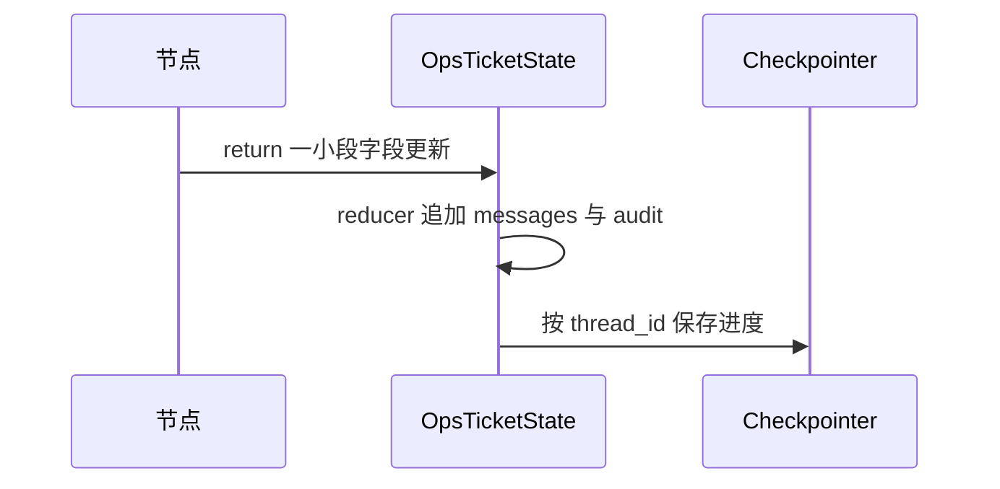

## 第 3 步：先做 PII 打码

新建 `src/ops_copilot/policy.py`，实现手机号和邮箱打码。先在 `policy.py` 写纯函数，不调用模型、不调用 MCP。

打码顺序固定为手机号再邮箱；返回替换数量，供 `pii.redacted` 审计使用。之后工具结果进入 `messages` 前，也要再次调用它。

```json coach
{
  "id": "redact-pii",
  "summary": "用可测试的纯函数阻断手机号和邮箱进入模型上下文",
  "prerequisites": ["define-state"],
  "next": ["fake-mcp"],
  "acceptance": ["policy.py 存在 redact", "手机号替换为 [PHONE]", "邮箱替换为 [EMAIL]", "返回替换计数"],
  "completion": {
    "all": [
      { "type": "file_exists", "path": "src/ops_copilot/policy.py" },
      { "type": "file_contains", "path": "src/ops_copilot/policy.py", "pattern": "def redact" },
      { "type": "file_contains", "path": "src/ops_copilot/policy.py", "pattern": "[PHONE]" },
      { "type": "file_contains", "path": "src/ops_copilot/policy.py", "pattern": "[EMAIL]" }
    ]
  },
  "hints": ["使用 re.compile 和 subn，subn 会同时给回替换后的文本与次数。", "手机号边界使用 (?<!\\d) 和 (?!\\d)，避免误伤更长数字串。"],
  "lineMode": [
    { "code": "text, n1 = PHONE.subn(\"[PHONE]\", text)", "explanation": "先替换手机号，并记录替换次数。" },
    { "code": "text, n2 = EMAIL.subn(\"[EMAIL]\", text)", "explanation": "再替换邮箱。" },
    { "code": "return text, n1 + n2", "explanation": "同时返回脱敏文本和审计所需计数。" }
  ]
}
```

```python
import re

PHONE = re.compile(r"(?<!\d)1[3-9]\d{9}(?!\d)")
EMAIL = re.compile(r"[\w.+-]+@[\w-]+\.[\w.-]+")

def redact(text: str) -> tuple[str, int]:
    text, phone_count = PHONE.subn("[PHONE]", text)
    text, email_count = EMAIL.subn("[EMAIL]", text)
    return text, phone_count + email_count
```

在 Python 交互环境输入 `redact("联系人 13800001111，邮箱 a@example.com")`，确认原值已消失且计数为 2。

## 第 4 步：实现带幂等保护的假 MCP

新建 `src/ops_copilot/mcp_client.py`。第一阶段不接真实 Jira 或日历，但四个工具名与参数形状必须按真实边界写。

`calls` 记录进入 MCP 的次数，`_idem` 记录真正生效的写操作。G4 断言的是后者，不要混淆。

```json coach
{
  "id": "fake-mcp",
  "summary": "用内存假服务模拟四个工具，并让写操作按 run_id:action_id 幂等",
  "prerequisites": ["redact-pii"],
  "next": ["fake-model"],
  "acceptance": ["实现 FakeMCP", "写工具强制要求 idem_key", "重复 key 返回第一次结果", "分别记录调用和真实写入"],
  "completion": {
    "all": [
      { "type": "file_exists", "path": "src/ops_copilot/mcp_client.py" },
      { "type": "file_contains", "path": "src/ops_copilot/mcp_client.py", "pattern": "class FakeMCP" },
      { "type": "file_contains", "path": "src/ops_copilot/mcp_client.py", "pattern": "idem_key" },
      { "type": "file_contains", "path": "src/ops_copilot/mcp_client.py", "pattern": "_idem" }
    ]
  },
  "hints": ["ticket.comment 和 calendar.hold 是写工具，其他两个是只读。", "重复 key 的分支必须在 _really_write 之前返回。"],
  "diagram": { "sourceId": "mcp-idem", "highlightMessages": [2, 3] }
}
```

```python
from collections import Counter

class FakeMCP:
    def __init__(self):
        self.calls = Counter()
        self.effects = Counter()
        self._idem = {}

    def call(self, tool, args, *, idem_key=None):
        self.calls[tool] += 1
        if tool in ("ticket.comment", "calendar.hold"):
            if not idem_key:
                raise ValueError("write tools require idem_key")
            if idem_key in self._idem:
                return self._idem[idem_key]
            result = self._really_write(tool, args)
            self._idem[idem_key] = result
            self.effects[tool] += 1
            return result
        return self._really_read(tool, args)

    def _really_read(self, tool, args):
        if tool == "kb.search":
            return [{"ref_id": "kb_1", "title": "连接池故障", "snippet": "先限制并发"}]
        if tool == "ticket.get":
            return {"ticket_id": args["ticket_id"], "status": "open", "title": "示例工单"}
        raise ValueError(f"unknown read tool: {tool}")

    def _really_write(self, tool, args):
        if tool == "ticket.comment":
            return {"ok": True, "comment_id": "cmt_1"}
        if tool == "calendar.hold":
            return {"ok": True, "hold_id": "h_1"}
        raise ValueError(f"unknown write tool: {tool}")
```

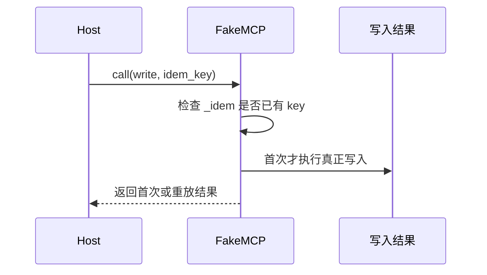

## 第 5 步：用固定 JSON 的假模型

新建 `src/ops_copilot/model.py`。假模型只返回结构化 `dict`，这样你可以先验证图、审批和工具边界，不把模型网络错误混进来。

不要在此文件调用真实模型，也不要让模型生成 `action_id` 或 `effect`。

```json coach
{
  "id": "fake-model",
  "summary": "把分类、规划、摘要三次模型调用做成可控夹具",
  "prerequisites": ["fake-mcp"],
  "next": ["graph-smoke"],
  "acceptance": ["实现 FakeModel", "分类输出固定枚举", "plan 输出 actions", "verify 输出 summary 与 continue"],
  "completion": {
    "all": [
      { "type": "file_exists", "path": "src/ops_copilot/model.py" },
      { "type": "file_contains", "path": "src/ops_copilot/model.py", "pattern": "class FakeModel" },
      { "type": "file_contains", "path": "src/ops_copilot/model.py", "pattern": "classification" },
      { "type": "file_contains", "path": "src/ops_copilot/model.py", "pattern": "continue" }
    ]
  },
  "hints": ["构造 FakeModel 时接收 classification、actions、continue_loop 三个参数。", "plan 返回 {'actions': self.actions}，不是直接返回 list。"]
}
```

```python
class FakeModel:
    def __init__(self, classification="incident", actions=None, continue_loop=False):
        self.classification = classification
        self.actions = actions or []
        self.continue_loop = continue_loop

    def classify(self, state):
        return {"classification": self.classification}

    def plan(self, state):
        return {"actions": self.actions}

    def verify(self, state):
        return {
            "summary": "已完成本次模拟处置",
            "continue": self.continue_loop,
        }
```

## 第 6 步：让最小图从 START 跑到 END

新建 `src/ops_copilot/graph.py`。本步只接 `kb.search` 只读链路：`ingest → classify → plan → tools → verify`。

`InMemorySaver` 可以先用于 M0，但它不能通过重启恢复测试，后面会换 SQLite。

```json coach
{
  "id": "graph-smoke",
  "summary": "完成 M0 最小图和只读工具闭环，证明节点、reducer 与编译配置能一起工作",
  "prerequisites": ["fake-model"],
  "next": ["verify-m0"],
  "acceptance": ["graph.py 使用 StateGraph", "包含五个基础节点", "使用 InMemorySaver 编译", "只读路径不需要 interrupt"],
  "completion": {
    "all": [
      { "type": "file_exists", "path": "src/ops_copilot/graph.py" },
      { "type": "file_contains", "path": "src/ops_copilot/graph.py", "pattern": "StateGraph" },
      { "type": "file_contains", "path": "src/ops_copilot/graph.py", "pattern": "def ingest" },
      { "type": "file_contains", "path": "src/ops_copilot/graph.py", "pattern": "def verify" },
      { "type": "file_contains", "path": "src/ops_copilot/graph.py", "pattern": "InMemorySaver" },
      { "type": "file_contains", "path": "src/ops_copilot/graph.py", "pattern": "ToolMessage" }
    ]
  },
  "hints": ["build_graph(model, mcp, checkpointer=None) 用闭包让节点访问假模型和假 MCP。", "先用固定边，不要在本步加入 approval_gate。"],
  "lineMode": [
    { "code": "builder = StateGraph(OpsTicketState)", "explanation": "让图内所有节点共享你定义的状态结构。" },
    { "code": "builder.add_node(\"ingest\", ingest)", "explanation": "把普通函数注册成图节点。" },
    { "code": "builder.add_edge(START, \"ingest\")", "explanation": "明确图从哪个节点开始。" },
    { "code": "return builder.compile(checkpointer=checkpointer or InMemorySaver())", "explanation": "编译成可 invoke 的图，并启用内存存档。" }
  ],
  "diagram": { "sourceId": "readonly-flow", "highlightMessages": [1, 2, 3, 4] }
}
```

```python
from langchain_core.messages import ToolMessage
from langgraph.graph import END, START, StateGraph
from langgraph.checkpoint.memory import InMemorySaver
from ops_copilot.state import OpsTicketState

MAX_STEPS = 6

def build_graph(model, mcp, checkpointer=None):
    def ingest(state):
        return {"run_status": "running", "audit": [{"ts": "test", "code": "run.started"}]}

    def classify(state):
        return model.classify(state)

    def plan(state):
        action = {
            "action_id": "read-1",
            "tool_name": "kb.search",
            "effect": "read",
            "args": {"query": state["ticket_id"]},
            "reason": "先查知识库",
            "ref_ids": list(state["offered_refs"]),
        }
        return {"proposed_actions": [action], "approvals": [], "round_no": state["round_no"] + 1}

    def tools(state):
        results = [mcp.call(a["tool_name"], a["args"]) for a in state["proposed_actions"]]
        message = ToolMessage(content=str(results), tool_call_id="read-1")
        return {"messages": [message], "audit": [{"ts": "test", "code": "tool.executed", "tool_name": "kb.search"}]}

    def verify(state):
        result = model.verify(state)
        return {
            "summary": result["summary"],
            "continue_loop": result["continue"],
            "step_count": state["step_count"] + 1,
            "run_status": "succeeded",
        }

    builder = StateGraph(OpsTicketState)
    builder.add_node("ingest", ingest)
    builder.add_node("classify", classify)
    builder.add_node("plan", plan)
    builder.add_node("tools", tools)
    builder.add_node("verify", verify)
    builder.add_edge(START, "ingest")
    builder.add_edge("ingest", "classify")
    builder.add_edge("classify", "plan")
    builder.add_edge("plan", "tools")
    builder.add_edge("tools", "verify")
    builder.add_edge("verify", END)
    return builder.compile(checkpointer=checkpointer or InMemorySaver())
```

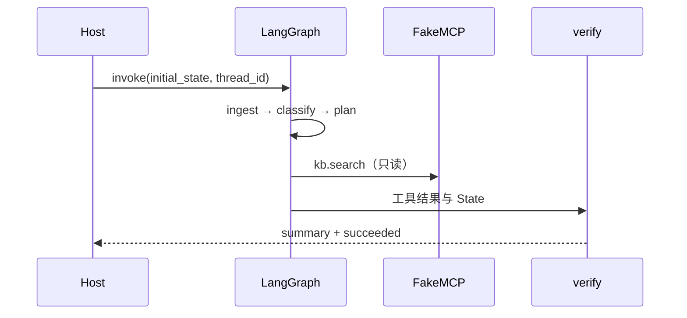

## 第 6A 步：运行 M0 阶段验收

现在补上一个真正能执行的入口 `src/ops_copilot/demo_m0.py`。它不是生产业务代码，而是学习阶段的冒烟验收入口：构造输入、调用图、检查结果。

只有终端实际输出 `M0 PASS`，才说明 M0 完成。CodeCoach 的文件检查只确认你已经写好验收入口，不能代替这次运行。

```json coach
{
  "id": "verify-m0",
  "summary": "通过 main → graph.invoke → assertions 证明 M0 不是只有文件，而是可以运行",
  "prerequisites": ["graph-smoke"],
  "next": ["approval-gate"],
  "acceptance": ["demo_m0.py 有 main 和模块入口", "真实调用 graph.invoke", "断言成功状态、只读调用和 reducer", "终端显示 M0 PASS（需你运行确认）"],
  "completion": {
    "all": [
      { "type": "file_exists", "path": "src/ops_copilot/demo_m0.py" },
      { "type": "file_contains", "path": "src/ops_copilot/demo_m0.py", "pattern": "def main" },
      { "type": "file_contains", "path": "src/ops_copilot/demo_m0.py", "pattern": "graph.invoke" },
      { "type": "file_contains", "path": "src/ops_copilot/demo_m0.py", "pattern": "M0 PASS" },
      { "type": "file_contains", "path": "src/ops_copilot/demo_m0.py", "pattern": "__main__" }
    ]
  },
  "verification": {
    "cwd": ".",
    "command": ["python", "-m", "ops_copilot.demo_m0"],
    "moduleFile": "src/ops_copilot/demo_m0.py",
    "expectedOutput": "M0 PASS",
    "manual": true
  },
  "hints": ["initial_state 至少要给当前节点使用的 ticket_id、offered_refs、round_no、step_count 等字段。", "如果断言失败，先看异常发生在哪个字段，不要绕过 assert。"],
  "lineMode": [
    { "code": "result = graph.invoke(make_initial_state(), config)", "explanation": "真正运行图，而不是只检查 graph.py 的文本。" },
    { "code": "assert result[\"run_status\"] == \"succeeded\"", "explanation": "把预期结果写成断言，失败时命令会明确报错。" },
    { "code": "print(f\"M0 PASS | status={result['run_status']} | kb.search={mcp.calls['kb.search']}\")", "explanation": "只有全部断言通过后才打印阶段通过标志。" }
  ],
  "diagram": { "sourceId": "m0-gate", "highlightMessages": [1, 2, 3] }
}
```

```python
from ops_copilot.graph import build_graph
from ops_copilot.mcp_client import FakeMCP
from ops_copilot.model import FakeModel

def make_initial_state():
    return {
        "thread_id": "thread-m0",
        "run_id": "run-m0",
        "ticket_id": "TCK-1042",
        "severity": "P1",
        "offered_refs": ["tck:TCK-1042"],
        "ref_table": {},
        "messages": [("human", "生产只读库连接池打满")],
        "proposed_actions": [],
        "approvals": [],
        "round_no": 0,
        "run_status": "running",
        "step_count": 0,
        "audit": [],
    }

def main():
    mcp = FakeMCP()
    graph = build_graph(FakeModel(), mcp)
    config = {"configurable": {"thread_id": "thread-m0"}}
    result = graph.invoke(make_initial_state(), config)

    assert result["run_status"] == "succeeded"
    assert result["step_count"] == 1
    assert mcp.calls["kb.search"] == 1
    assert mcp.effects["ticket.comment"] == 0
    assert mcp.effects["calendar.hold"] == 0
    assert len(result["messages"]) == 2
    assert len(result["audit"]) == 2

    print(f"M0 PASS | status={result['run_status']} | kb.search={mcp.calls['kb.search']}")
    print(f"messages={len(result['messages'])} | audit={len(result['audit'])} | summary={result['summary']}")

if __name__ == "__main__":
    main()
```

在虚拟环境已激活的项目根目录运行：

```powershell
python -m ops_copilot.demo_m0
```

预期第一行类似：

```text
M0 PASS | status=succeeded | kb.search=1
```

如果看到 `ModuleNotFoundError: No module named 'ops_copilot'`，先看终端当前目录，不要先改代码：如果你位于 `src/ops_copilot`，先返回项目根目录，再执行 `python -m ops_copilot.demo_m0`；如果已经位于项目根目录，回到第 1 步确认执行过 `python -m pip install -e ".[dev]"`。浮窗的验收卡片会显示你实际选择的工作区和可复制命令。如果是断言失败，则当前实现还不满足 M0，不要进入下一步。

如果最后几行是 `ToolMessage ... KeyError: 'tool_call_id'`，说明 `tools` 节点把 `("tool", ...)` 二元组交给了 `add_messages`，却没有提供工具调用 ID。不要删除 `add_messages` 或捕获异常绕过；应改为 `ToolMessage(content=str(results), tool_call_id="read-1")`，并保留教程中的正确 import。

排查其他异常时，先看 traceback 最后一行的错误类型和缺失字段，再向上找最近出现的消息类型或节点名称；不要从几百行堆栈的第一行开始猜。修改后重新运行同一个命令，只有全部断言通过才进入下一步。

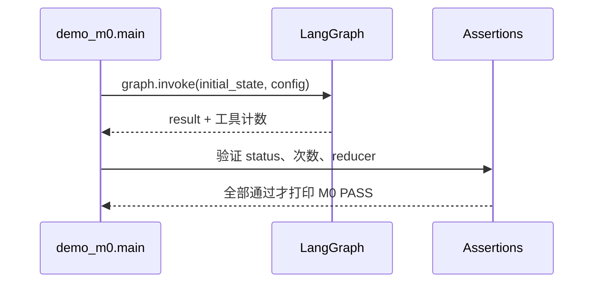

## 第 7 步：加入 approval_gate 暂停与恢复

在 `graph.py` 增加 `approval_gate` 和 `route_after_plan`，把 `plan → tools` 改成条件边。存在未决定的副作用时才进入审批。

核心规则：`interrupt()` 之前只能做确定性纯计算；MCP 永远留到 `tools`。恢复时节点会从函数开头重跑。

```json coach
{
  "id": "approval-gate",
  "summary": "实现 M1 核心：副作用动作暂停，Command(resume) 后才写入 approvals",
  "prerequisites": ["verify-m0"],
  "next": ["validate-plan"],
  "acceptance": ["实现 approval_gate", "interrupt 前没有 MCP", "pending 为空时不暂停", "plan 使用条件路由"],
  "completion": {
    "all": [
      { "type": "file_contains", "path": "src/ops_copilot/graph.py", "pattern": "def approval_gate" },
      { "type": "file_contains", "path": "src/ops_copilot/graph.py", "pattern": "interrupt(payload)" },
      { "type": "file_contains", "path": "src/ops_copilot/graph.py", "pattern": "def route_after_plan" },
      { "type": "file_contains", "path": "src/ops_copilot/graph.py", "pattern": "add_conditional_edges" }
    ]
  },
  "hints": ["从 langgraph.types 导入 interrupt；decisions = interrupt(payload) 的返回值才是审批结果。", "条件边映射为 {'approval_gate': 'approval_gate', 'tools': 'tools'}，并把 approval_gate 指向 tools。"],
  "lineMode": [
    { "code": "pending = [a for a in state[\"proposed_actions\"] if a[\"effect\"] == \"side_effect\"]", "explanation": "先只筛选需要人审的动作，这是可重入纯计算。" },
    { "code": "decisions = interrupt(payload)", "explanation": "第一次暂停；恢复时返回 Command(resume=...) 的决定。" },
    { "code": "return {\"approvals\": decisions, \"run_status\": \"running\"}", "explanation": "把人的决定写回 State，仍不能在这里调 MCP。" }
  ],
  "diagram": { "sourceId": "approval-flow", "highlightMessages": [2, 3, 4] }
}
```

```python
from langgraph.types import interrupt

def approval_gate(state):
    decided = {d["action_id"] for d in state.get("approvals", [])}
    pending = [a for a in state["proposed_actions"] if a["effect"] == "side_effect" and a["action_id"] not in decided]
    if not pending:
        return {}
    payload = {
        "type": "approval_required",
        "ticket_id": state["ticket_id"],
        "round_no": state["round_no"],
        "deadline_at": state.get("deadline_at"),
        "actions": pending,
    }
    decisions = interrupt(payload)
    if not isinstance(decisions, list) or not decisions:
        raise ValueError("resume payload must be a non-empty list")
    return {"approvals": decisions, "run_status": "running"}

def route_after_plan(state):
    decided = {d["action_id"] for d in state.get("approvals", [])}
    pending = [a for a in state["proposed_actions"] if a["effect"] == "side_effect" and a["action_id"] not in decided]
    return "approval_gate" if pending else "tools"
```

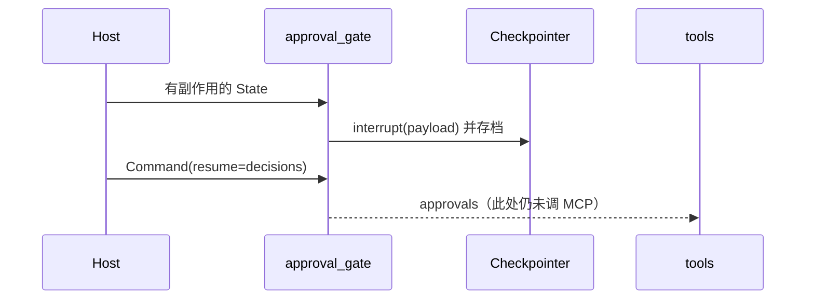

## 第 8 步：给模型输出加上策略闸门

回到 `policy.py`，增加 `args_ok()` 和 `validate_plan()`。模型只能提议；host 负责白名单、参数、引用、effect 和 `action_id`。

然后在 `graph.py` 的 `plan` 中调用 `validate_plan(model.plan(state), state)`，替换第 6 步写死的只读动作。

```json coach
{
  "id": "validate-plan",
  "summary": "落实 G5 与默认拒绝：未知工具、伪造 ref、非法参数都不能进入执行清单",
  "prerequisites": ["approval-gate"],
  "next": ["execute-approved"],
  "acceptance": ["validate_plan 检查 TOOL_REGISTRY", "effect 由 host 查表", "ref_ids 必须是 offered_refs 子集", "action_id 由 host 生成"],
  "completion": {
    "all": [
      { "type": "file_contains", "path": "src/ops_copilot/policy.py", "pattern": "def validate_plan" },
      { "type": "file_contains", "path": "src/ops_copilot/policy.py", "pattern": "TOOL_REGISTRY" },
      { "type": "file_contains", "path": "src/ops_copilot/policy.py", "pattern": "offered_refs" },
      { "type": "file_contains", "path": "src/ops_copilot/policy.py", "pattern": "action_id" }
    ]
  },
  "hints": ["用 from ulid import ULID，action_id 可写成 str(ULID())。", "calendar.hold 只允许 P1 且 classification 不是 unknown；ticket_id 必须等于当前工单。"]
}
```

```python
from ulid import ULID
from ops_copilot.state import TOOL_REGISTRY

FORBIDDEN_KEYS = {"token", "password", "secret"}

def args_ok(name, args):
    if not isinstance(args, dict) or FORBIDDEN_KEYS.intersection(args):
        return False
    if name == "kb.search":
        return isinstance(args.get("query"), str) and len(args["query"]) <= 200
    if name in ("ticket.get", "ticket.comment"):
        return isinstance(args.get("ticket_id"), str)
    if name == "calendar.hold":
        return isinstance(args.get("minutes"), int) and 1 <= args["minutes"] <= 480
    return False

def validate_plan(raw, state, audit):
    output = []
    offered = set(state["offered_refs"])
    for item in (raw.get("actions") or [])[:3]:
        name = item.get("tool_name")
        args = item.get("args") or {}
        refs = set(item.get("ref_ids") or [])
        if name not in TOOL_REGISTRY or not args_ok(name, args) or not refs.issubset(offered):
            audit("tool.denied", tool_name=str(name), detail="invalid_plan")
            continue
        if state.get("classification") == "unknown" and TOOL_REGISTRY[name]["effect"] == "side_effect":
            audit("plan.downgraded", tool_name=name)
            continue
        if name == "calendar.hold" and state["severity"] != "P1":
            audit("tool.denied", tool_name=name, detail="severity")
            continue
        if name in ("ticket.get", "ticket.comment") and args.get("ticket_id") != state["ticket_id"]:
            audit("tool.denied", tool_name=name, detail="wrong_ticket")
            continue
        output.append({
            "action_id": str(ULID()),
            "tool_name": name,
            "effect": TOOL_REGISTRY[name]["effect"],
            "args": args,
            "reason": str(item.get("reason") or "")[:200],
            "ref_ids": list(refs),
        })
    return output
```

`validate_plan` 的 `audit` 参数是一个追加审计的函数，由 graph 注入。每轮 `plan` 还要清空 `approvals`、替换 `proposed_actions` 并设置 `deadline_at`。

## 第 9 步：只执行只读或已批准动作

修改 `graph.py` 的 `tools`：只读动作可直接执行；副作用必须在本轮 `approvals` 中有 `approve` 或 `edit`。`reject` 不执行。

所有 MCP 写操作都使用 `f"{state['run_id']}:{action['action_id']}"` 作为幂等键。工具结果进 `messages` 前再次 `redact()`。

```json coach
{
  "id": "execute-approved",
  "summary": "落实 G2/G4：未批准写次数为 0，批准后同一动作真正生效至多一次",
  "prerequisites": ["validate-plan"],
  "next": ["core-tests"],
  "acceptance": ["tools 按 approvals 过滤副作用", "edit 使用重新校验后的 edited_args", "写 MCP 带 run_id:action_id", "工具结果二次打码"],
  "completion": {
    "all": [
      { "type": "file_contains", "path": "src/ops_copilot/graph.py", "pattern": "approvals" },
      { "type": "file_contains", "path": "src/ops_copilot/graph.py", "pattern": "idem_key" },
      { "type": "file_contains", "path": "src/ops_copilot/graph.py", "pattern": "run_id" },
      { "type": "file_contains", "path": "src/ops_copilot/graph.py", "pattern": "redact" },
      { "type": "file_contains", "path": "src/ops_copilot/graph.py", "pattern": "ToolMessage" }
    ]
  },
  "hints": ["先把 decisions 建成 action_id → decision 的字典，再逐条动作判断。", "edit 后再次调用 args_ok；decision 为 reject 时 continue。"],
  "diagram": { "sourceId": "trusted-tools", "highlightMessages": [1, 2, 3, 4] }
}
```

```python
from langchain_core.messages import ToolMessage

def tools(state):
    decisions = {d["action_id"]: d for d in state.get("approvals", [])}
    messages = []
    for action in state["proposed_actions"]:
        decision = decisions.get(action["action_id"])
        if action["effect"] == "side_effect":
            if not decision or decision["decision"] == "reject":
                continue
            args = decision.get("edited_args", action["args"]) if decision["decision"] == "edit" else action["args"]
            if not args_ok(action["tool_name"], args):
                continue
            idem_key = f"{state['run_id']}:{action['action_id']}"
        else:
            args = action["args"]
            idem_key = None
        result = mcp.call(action["tool_name"], args, idem_key=idem_key)
        safe_result, _ = redact(str(result))
        messages.append(ToolMessage(content=safe_result, tool_call_id=action["action_id"]))
    return {"messages": messages}
```

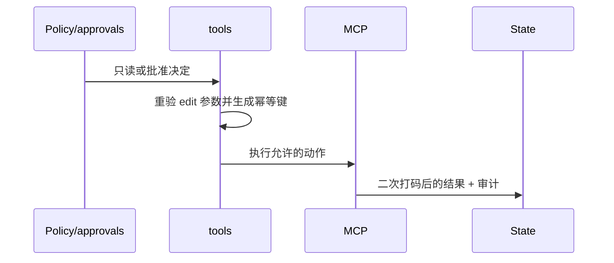

## 第 10 步：先让人审核心测试变绿

在 `tests/` 新建 `test_interrupt_resume.py`、`test_policy_denies_unapproved_side_effect.py`、`test_pii_redaction.py`。

至少覆盖：只读不暂停、未批准评论为 0、批准后只写一次、伪造 ref 被拒绝、手机号和邮箱被脱敏。运行 `pytest -k "interrupt or unapproved or pii"`。

```json coach
{
  "id": "core-tests",
  "summary": "用测试证明 M1，而不是仅凭界面上出现了一个 409",
  "prerequisites": ["execute-approved"],
  "next": ["verify-m1"],
  "acceptance": ["有人审恢复测试", "有未批准副作用测试", "有 PII 测试", "测试断言真实写入次数"],
  "completion": {
    "all": [
      { "type": "file_exists", "path": "tests/test_interrupt_resume.py" },
      { "type": "file_exists", "path": "tests/test_policy_denies_unapproved_side_effect.py" },
      { "type": "file_exists", "path": "tests/test_pii_redaction.py" },
      { "type": "file_contains", "path": "tests/test_policy_denies_unapproved_side_effect.py", "pattern": "ticket.comment" }
    ]
  },
  "hints": ["用固定 initial_state 和 config={'configurable': {'thread_id': 'test-thread'}}。", "第一次 invoke 后检查 __interrupt__；不要 resume，直接断言 mcp.effects['ticket.comment'] == 0。"],
  "lineMode": [
    { "code": "result = graph.invoke(initial_state, config)", "explanation": "运行到会规划评论的图，预期停在人审。" },
    { "code": "assert \"__interrupt__\" in result", "explanation": "确认确实暂停，而不是直接完成。" },
    { "code": "assert mcp.effects[\"ticket.comment\"] == 0", "explanation": "G2 的核心：没有批准，真正写入必须为零。" }
  ]
}
```

```python
def test_deny_unapproved_side_effect(graph, initial_state, config, mcp):
    result = graph.invoke(initial_state, config)
    assert "__interrupt__" in result
    assert result["__interrupt__"][0].value["actions"][0]["tool_name"] == "ticket.comment"
    assert mcp.effects["ticket.comment"] == 0

def test_resume_executes_once(graph, initial_state, config, mcp):
    from langgraph.types import Command
    first = graph.invoke(initial_state, config)
    action = first["__interrupt__"][0].value["actions"][0]
    decision = [{"action_id": action["action_id"], "decision": "approve", "actor_id": "u_test"}]
    graph.invoke(Command(resume=decision), config)
    assert mcp.effects["ticket.comment"] == 1
```

测试夹具负责构造 `graph`、`mcp`、`initial_state` 和 `config`。本步只验证第一次批准；第二次恢复应该被 HTTP 状态校验挡住，M2 会写真正的重放测试。

## 第 10A 步：运行 M1 阶段验收

新建 `src/ops_copilot/demo_m1.py`，把“暂停前不能写、批准后才能写”串成一个真实可执行故事。这里复用 M0 的 `make_initial_state()`，不再复制一份输入。

只有 `M1 PASS` 和本步 pytest 都通过，M1 才算完成。不要只看 409：必须同时证明暂停前写入为 0、恢复后写入为 1。

```json coach
{
  "id": "verify-m1",
  "summary": "通过可执行 demo 验证 interrupt → 零写入 → Command(resume) → 恰好一次写入",
  "prerequisites": ["core-tests"],
  "next": ["http-runs"],
  "acceptance": ["demo_m1.py 有 main 和模块入口", "首次 invoke 断言 interrupt 和零副作用", "resume 后断言一次副作用", "终端显示 M1 PASS 且相关 pytest 通过（需你运行确认）"],
  "completion": {
    "all": [
      { "type": "file_exists", "path": "src/ops_copilot/demo_m1.py" },
      { "type": "file_contains", "path": "src/ops_copilot/demo_m1.py", "pattern": "def main" },
      { "type": "file_contains", "path": "src/ops_copilot/demo_m1.py", "pattern": "__interrupt__" },
      { "type": "file_contains", "path": "src/ops_copilot/demo_m1.py", "pattern": "Command(resume" },
      { "type": "file_contains", "path": "src/ops_copilot/demo_m1.py", "pattern": "M1 PASS" },
      { "type": "file_contains", "path": "src/ops_copilot/demo_m1.py", "pattern": "__main__" }
    ]
  },
  "verification": {
    "cwd": ".",
    "command": ["python", "-m", "ops_copilot.demo_m1"],
    "moduleFile": "src/ops_copilot/demo_m1.py",
    "expectedOutput": "M1 PASS",
    "manual": true
  },
  "hints": ["从第一次返回的 interrupt payload 取 action_id，不要自己编造。", "批准前断言的是 mcp.effects，不是 mcp.calls；真正写入次数才对应 G2/G4。"],
  "lineMode": [
    { "code": "paused = graph.invoke(make_initial_state(), config)", "explanation": "运行到副作用审批点并保存第一次结果。" },
    { "code": "assert mcp.effects[\"ticket.comment\"] == 0", "explanation": "在恢复之前证明没有真实评论。" },
    { "code": "result = graph.invoke(Command(resume=decisions), config)", "explanation": "用人的决定恢复同一个 thread，而不是重新输入 State。" }
  ],
  "diagram": { "sourceId": "m1-gate", "highlightMessages": [1, 2, 3, 4] }
}
```

```python
from langgraph.types import Command
from ops_copilot.demo_m0 import make_initial_state
from ops_copilot.graph import build_graph
from ops_copilot.mcp_client import FakeMCP
from ops_copilot.model import FakeModel

def main():
    mcp = FakeMCP()
    model = FakeModel(actions=[{
        "tool_name": "ticket.comment",
        "args": {"ticket_id": "TCK-1042", "body": "已完成初步处置"},
        "reason": "告知提单人",
        "ref_ids": ["tck:TCK-1042"],
    }])
    graph = build_graph(model, mcp)
    config = {"configurable": {"thread_id": "thread-m1"}}

    paused = graph.invoke(make_initial_state(), config)
    assert "__interrupt__" in paused
    assert mcp.effects["ticket.comment"] == 0
    print("PAUSED | ticket.comment effects=0")

    action = paused["__interrupt__"][0].value["actions"][0]
    decisions = [{
        "action_id": action["action_id"],
        "decision": "approve",
        "actor_id": "u_test",
    }]
    result = graph.invoke(Command(resume=decisions), config)

    assert result["run_status"] == "succeeded"
    assert mcp.effects["ticket.comment"] == 1
    print("M1 PASS | interrupt=1 | comment effects=1")

if __name__ == "__main__":
    main()
```

依次运行：

```powershell
python -m ops_copilot.demo_m1
python -m pytest -q -k "interrupt or unapproved or pii"
```

预期先看到 `PAUSED | ticket.comment effects=0`，最后看到 `M1 PASS | interrupt=1 | comment effects=1`，pytest 全部通过。若首次运行就产生评论，说明副作用位置错误；若恢复后仍为 0，检查条件边和 approvals；若超过 1，检查重入副作用与幂等键。

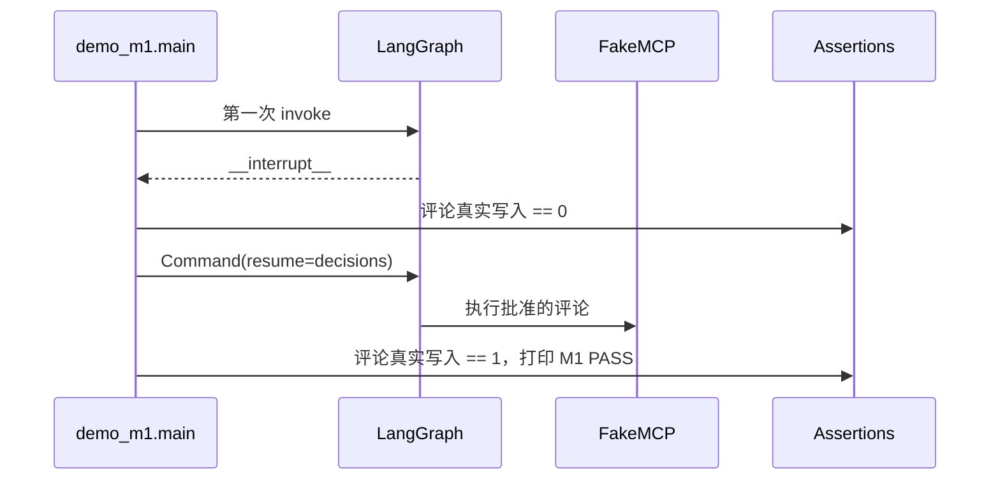

## 第 11 步：实现线程与 runs 的 HTTP 契约

新建 `src/ops_copilot/store.py` 和 `src/ops_copilot/api.py`。先用内存存储实现 `thread/run/idempotency` 接口，再写 FastAPI：

- `PUT /v1/threads/{thread_id}`：登记存档槽与 token 对应的 owner。
- `POST /v1/threads/{thread_id}/runs`：创建新 `run_id`，调用图。
- 图出现 `__interrupt__` 时返回 **409 + InterruptedRun**，不是 200，也不是 ErrorBody。

```json coach
{
  "id": "http-runs",
  "summary": "开始 M2：把跑图包装成 HTTP，并把人审 409 与错误 409 分开",
  "prerequisites": ["verify-m1"],
  "next": ["http-resume"],
  "acceptance": ["store.py 管理 thread/run/idempotency", "api.py 提供 PUT thread", "POST runs 返回 run_id", "interrupt 映射为 409 interrupt body"],
  "completion": {
    "all": [
      { "type": "file_exists", "path": "src/ops_copilot/store.py" },
      { "type": "file_exists", "path": "src/ops_copilot/api.py" },
      { "type": "file_contains", "path": "src/ops_copilot/api.py", "pattern": "FastAPI" },
      { "type": "file_contains", "path": "src/ops_copilot/api.py", "pattern": "__interrupt__" },
      { "type": "file_contains", "path": "src/ops_copilot/api.py", "pattern": "status_code=409" }
    ]
  },
  "hints": ["练习鉴权可让 dev-token 映射 u_dev，但 actor_id 不读取请求体。", "result['__interrupt__'][0].value 才是前端需要的 approval payload。"],
  "lineMode": [
    { "code": "result = graph.invoke(initial_state, config)", "explanation": "同步执行图，直到结束或遇到 interrupt。" },
    { "code": "if \"__interrupt__\" in result:", "explanation": "先区分人审暂停与普通完成。" },
    { "code": "return JSONResponse(status_code=409, content=interrupt_body)", "explanation": "人审必须使用专门的 Interrupted JSON。" }
  ],
  "diagram": { "sourceId": "http-runs-flow", "highlightMessages": [1, 2, 3] }
}
```

```python
from fastapi import FastAPI
from fastapi.responses import JSONResponse

app = FastAPI()

@app.post("/v1/threads/{thread_id}/runs")
def create_run(thread_id: str, request: RunRequest, authorization: str = Header(...)):
    actor_id = actor_from_token(authorization)
    run_id = str(ULID())
    initial_state = make_initial_state(thread_id, run_id, request.ticket)
    result = graph.invoke(initial_state, config_for(thread_id))
    if "__interrupt__" in result:
        payload = result["__interrupt__"][0].value
        return JSONResponse(status_code=409, content={
            "thread_id": thread_id,
            "run_id": run_id,
            "status": "interrupted",
            "interrupt": payload,
        })
    return {"thread_id": thread_id, "run_id": run_id, "status": result["run_status"]}
```

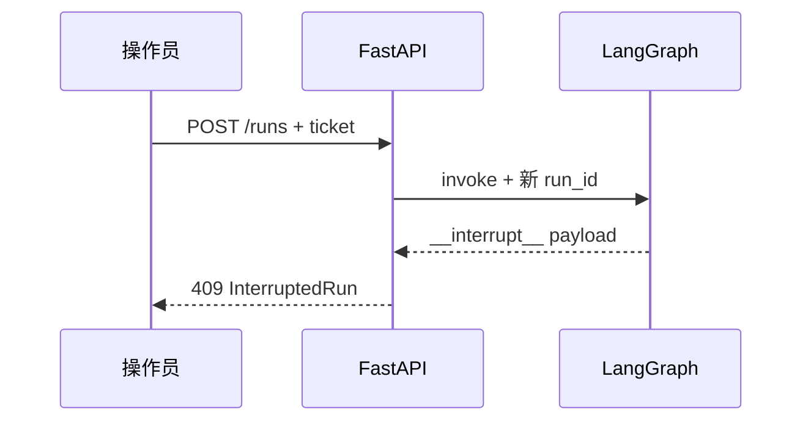

## 第 12 步：实现 resume 四道校验与投影

在 `api.py` 增加 `POST /v1/threads/{thread_id}/resume` 和 `GET /v1/threads/{thread_id}`。

恢复顺序：thread 存在 → token/owner → checkpointer 确实 pending → decisions 完整且参数合法。成功时用同一个 `thread_id` 和 `Command(resume=decisions)`。

GET 只返回投影，不返回完整 messages、checkpoint、令牌或原始 PII。

```json coach
{
  "id": "http-resume",
  "summary": "让人可以通过另一个 HTTP 请求批准，并以 checkpointer 为暂停事实源",
  "prerequisites": ["http-runs"],
  "next": ["http-idempotency"],
  "acceptance": ["使用 Command(resume=decisions)", "无暂停返回 409 not_interrupted", "校验 decisions 覆盖本轮 pending", "GET 投影不返回 messages"],
  "completion": {
    "all": [
      { "type": "file_contains", "path": "src/ops_copilot/api.py", "pattern": "Command(resume" },
      { "type": "file_contains", "path": "src/ops_copilot/api.py", "pattern": "not_interrupted" },
      { "type": "file_contains", "path": "src/ops_copilot/api.py", "pattern": "get_state" },
      { "type": "file_contains", "path": "src/ops_copilot/api.py", "pattern": "def get_thread" }
    ]
  },
  "hints": ["snap = graph.get_state(config)，用 any(t.interrupts for t in snap.tasks) 判断是否 pending。", "edit 必须带 edited_args，且不能借 edit 修改 tool_name；修改后重新 args_ok。"],
  "diagram": { "sourceId": "resume-flow", "highlightMessages": [1, 2, 3, 4] }
}
```

```python
from langgraph.types import Command

@app.post("/v1/threads/{thread_id}/resume")
def resume(thread_id: str, request: ResumeRequest, authorization: str = Header(...)):
    actor_id = actor_from_token(authorization)
    thread = require_owned_thread(thread_id, actor_id)
    config = config_for(thread_id)
    snapshot = graph.get_state(config)
    if not any(task.interrupts for task in snapshot.tasks):
        return error_response(409, "not_interrupted", "当前没有待批准动作")
    decisions = validate_decisions(request.decisions, snapshot, actor_id)
    result = graph.invoke(Command(resume=decisions), config)
    return run_response(thread_id, thread.run_id, result)

@app.get("/v1/threads/{thread_id}")
def get_thread(thread_id: str, authorization: str = Header(...)):
    actor_id = actor_from_token(authorization)
    require_owned_thread(thread_id, actor_id)
    values = graph.get_state(config_for(thread_id)).values
    return project_public_state(thread_id, values)
```

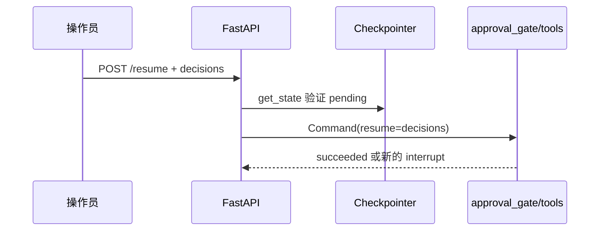

## 第 13 步：实现 HTTP 幂等重放

给 runs 和 resume 增加必需的 `Idempotency-Key`。同 key、同规范化 body 哈希时，直接返回第一次保存的 `status_code + body`，不得再次调用图。

同 key 但 body 不同，返回 `409 idempotency_key_reuse`。不同 key 的第二次 resume 应由 `not_interrupted` 挡住，评论仍只有一条。

```json coach
{
  "id": "http-idempotency",
  "summary": "落实 G4 的 HTTP 防线：重放响应，不重复执行写操作",
  "prerequisites": ["http-resume"],
  "next": ["sqlite-restart"],
  "acceptance": ["要求 Idempotency-Key", "body 使用规范化哈希", "幂等记录包含 scope/status_code/body", "重复请求直接返回第一次响应"],
  "completion": {
    "all": [
      { "type": "file_contains", "path": "src/ops_copilot/api.py", "pattern": "Idempotency-Key" },
      { "type": "file_contains", "path": "src/ops_copilot/api.py", "pattern": "request_hash" },
      { "type": "file_contains", "path": "src/ops_copilot/store.py", "pattern": "idempotency" },
      { "type": "file_contains", "path": "src/ops_copilot/store.py", "pattern": "status_code" }
    ]
  },
  "hints": ["scope 使用 method + path 模板，避免 runs 的 key 被用于 resume。", "json.dumps(body, sort_keys=True, separators=(',', ':')) 后再 sha256。"],
  "lineMode": [
    { "code": "request_hash = sha256(canonical_body.encode()).hexdigest()", "explanation": "对规范化请求体计算哈希，而不是依赖原始空白。" },
    { "code": "saved = store.get_idem(key, scope)", "explanation": "先查同一路由范围内的幂等记录。" },
    { "code": "return replay(saved)", "explanation": "同 key 同 body 时直接重放，不进入 graph.invoke。" }
  ]
}
```

```python
def replay_or_execute(key, scope, body, execute):
    canonical = json.dumps(body, sort_keys=True, separators=(",", ":"))
    request_hash = hashlib.sha256(canonical.encode()).hexdigest()
    saved = store.get_idem(key, scope)
    if saved:
        if saved.request_hash != request_hash:
            return error_response(409, "idempotency_key_reuse", "同一 key 不能用于不同请求")
        return JSONResponse(status_code=saved.status_code, content=saved.body)
    response = execute()
    store.put_idem(key, scope, request_hash, response.status_code, response.body)
    return response
```

新增 `tests/test_idempotent_resume.py`：同 key 两次 resume 的响应完全相同且评论为 1；不同 key 第二次为 `not_interrupted` 且评论仍为 1。

## 第 14 步：换 SQLite，验证重启后还能批准

把 `InMemorySaver` 换成 `SqliteSaver`，数据库文件放在练习目录的 `checkpoints.sqlite`。API 重启时必须重新打开同一个文件，并使用原来的 `thread_id`。

G1 测试流程：进程 A 创建 run 得到 409 → 关闭 A → 进程 B 使用同一 SQLite 和 thread_id resume → 评论恰好 1 条，分类没有重算。

```json coach
{
  "id": "sqlite-restart",
  "summary": "落实 G1：把暂停状态放到进程之外的 SQLite，而不是内存或全局变量",
  "prerequisites": ["http-idempotency"],
  "next": ["final-acceptance"],
  "acceptance": ["使用 SqliteSaver", "数据库文件可跨进程复用", "恢复沿用同一个 thread_id", "新增重启恢复测试"],
  "completion": {
    "all": [
      { "type": "file_contains", "path": "src/ops_copilot/graph.py", "pattern": "SqliteSaver" },
      { "type": "file_contains", "path": "src/ops_copilot/graph.py", "pattern": "checkpoints.sqlite" },
      { "type": "file_exists", "path": "tests/test_resume_after_restart.py" },
      { "type": "file_contains", "path": "tests/test_resume_after_restart.py", "pattern": "ticket.comment" }
    ]
  },
  "hints": ["从 langgraph.checkpoint.sqlite import SqliteSaver。", "连接需要跨 FastAPI 线程使用时检查 check_same_thread=False，并给写操作加锁；不要在每次请求生成新数据库。"],
  "diagram": { "sourceId": "restart-flow", "highlightMessages": [2, 3, 4] }
}
```

```python
import sqlite3
from langgraph.checkpoint.sqlite import SqliteSaver

connection = sqlite3.connect("checkpoints.sqlite", check_same_thread=False)
checkpointer = SqliteSaver(connection)
graph = build_graph(model, mcp, checkpointer=checkpointer)
```

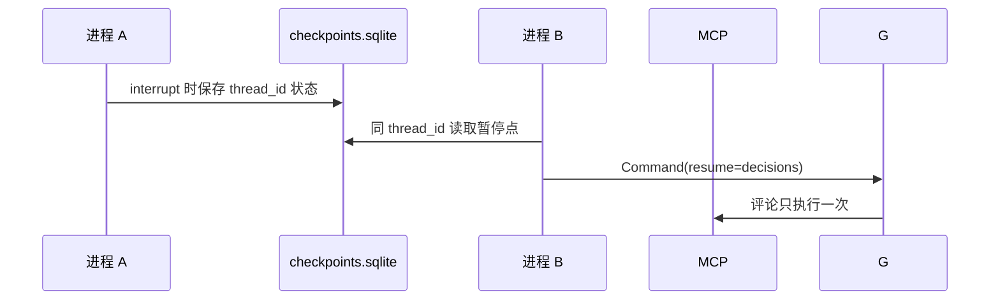

同时把你自己的 thread/run/idempotency 表迁移到 SQLite。checkpointer 只负责图，不负责 owner、截止时间和 HTTP 幂等记录。

## 第 15 步：运行 M2 阶段验收与全量回归

M2 的验收入口是 pytest，不需要再添加生产主函数。HTTP 契约用 FastAPI `TestClient` 验证真实请求和状态码；G1 用两个独立 Python 进程验证重启恢复。

**不能用同一个 graph 对象调用两次冒充进程重启。** `test_resume_after_restart.py` 应通过 `subprocess` 分别启动进程 A 和 B，并让它们使用同一个 SQLite 文件与 thread_id。

逐条确认业务结果：

- G1：SQLite 新进程可恢复，评论恰好一次，分类不重算。
- G2：未批准前 `ticket.comment` 和 `calendar.hold` 的真实写入均为 0。
- G3：只有只读动作时不出现人审 409。
- G4：同 key 重放响应；不同 key 第二次被状态校验挡住；评论都只有一次。
- G5：伪造 `tck:TCK-9999` 不得进入 actions 或 MCP，并有 `tool.denied`。
- 额外：`unknown` 保守降级、最多 6 圈、超时、edit 重验、GET 无 PII/messages。

```json coach
{
  "id": "final-acceptance",
  "summary": "用 TestClient、独立进程和全量 pytest 验证 M2，而不是只确认接口代码存在",
  "prerequisites": ["sqlite-restart"],
  "next": [],
  "acceptance": ["HTTP 测试使用 TestClient", "G1 使用 subprocess 验证独立进程", "幂等、投影、步数和超时测试存在", "分组验收及全量 pytest 通过（需你运行确认）"],
  "completion": {
    "all": [
      { "type": "file_exists", "path": "tests/test_idempotent_resume.py" },
      { "type": "file_exists", "path": "tests/test_http_contract.py" },
      { "type": "file_contains", "path": "tests/test_http_contract.py", "pattern": "TestClient" },
      { "type": "file_contains", "path": "tests/test_http_contract.py", "pattern": "projection_no_pii" },
      { "type": "file_contains", "path": "tests/test_http_contract.py", "pattern": "step_limit" },
      { "type": "file_contains", "path": "tests/test_http_contract.py", "pattern": "approval_timeout" },
      { "type": "file_contains", "path": "tests/test_resume_after_restart.py", "pattern": "subprocess" }
    ]
  },
  "verification": {
    "cwd": ".",
    "command": ["python", "-m", "pytest", "-q"],
    "expectedOutput": "passed",
    "manual": true
  },
  "hints": ["把假模型永远 continue=True，验证最多 6 圈并记录 step_limit。", "G1 的进程 A 只负责暂停，进程 B 才 resume；分类计数和评论计数要能从测试证据中核对。"],
  "diagram": { "sourceId": "final-flow", "highlightMessages": [1, 2, 3, 4, 5] }
}
```

下面是一个 HTTP 验收示例。`client` 是 `TestClient(app)` 夹具，`make_ticket()` 只返回只读测试所需工单；请求头要同时带开发 token 和幂等键。

```python
def test_g3_readonly_never_interrupts(client, make_ticket):
    response = client.post(
        "/v1/threads/thread-readonly/runs",
        json=make_ticket(),
        headers={"Authorization": "Bearer dev-token", "Idempotency-Key": "readonly-001"},
    )
    assert response.status_code == 200
    assert response.json()["status"] == "succeeded"
    assert "interrupt" not in response.json()
```

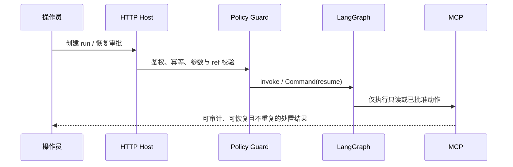

按顺序运行三组验收，不要直接跳过失败继续：

```powershell
python -m pytest -q -k "readonly or unapproved or idempotent or ref_integrity"
python -m pytest -q tests/test_resume_after_restart.py
python -m pytest -q
```

通过标准：

1. 第一组证明只读、未批准、幂等和引用完整性全部通过。
2. 第二组证明独立进程 B 能恢复，评论恰好一次且分类没有重算。
3. 第三组全量测试无失败、无错误；不能把测试跳过当成通过。

三组命令都通过，并且你能解释 G1～G5 的证据时，M2 和这份教程才真正完成。之后可以接真实模型，但不要改变 host 的审批、白名单、幂等与脱敏边界。
